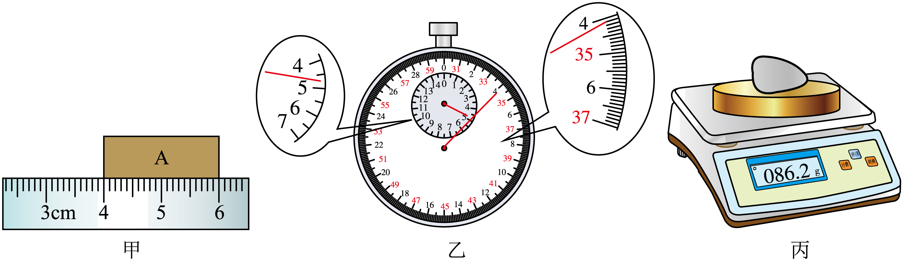

# Physics - 题目 372

**ID**: d46a2edc7dd74dbf904109f621df1d1c
**年级**: Grade 8
**难度**: Medium
**题型**: Comprehensive

## 题目
亲爱的同学，你会使用以下基本仪器吗？（1）如图甲所示，刻度尺的分度值为mm，物体A的长度为cm。​​​​​​​‌（2）如图乙所示，该秒表的分度值是，秒表的读数是s。（3）如图丙所示，用电子天平测小石块质量时，应先将电子天平放在桌面上，通电后，若显示示数不为“0”，则需按一下面板上的按键进行调零。此石块的质量是g。

## 解答

1. （1）根据图中显示，刻度尺的最小分度值为1mm，被测物体的起始刻度是 $4.00{\rm{c}}{\rm{m}}$ ，终了刻度是 $6.00{\rm{c}}{\rm{m}}$ ，物体的长度为 $6.00{\rm{c}}{\rm{m}}-4.00{\rm{c}}{\rm{m}}=2.00{\rm{c}}{\rm{m}}$
2. （2）图示测量时间的工具为秒表，小盘的分度值是 $0.5{\rm{m}}{\rm{i}}{\rm{n}}$ ，指针在 ${\rm{4}}{\rm{m}}{\rm{i}}{\rm{n}}$ 和 $5{\rm{m}}{\rm{i}}{\rm{n}}$ 之间，偏向5一侧；大盘的分度值是 $0.2{\rm{s}}$ ，而大盘指针在 $34.2{\rm{s}}$ ，因此秒表读数为 $4{\rm{m}}{\rm{i}}{\rm{n}}34.2{\rm{s}}=4\times 60{\rm{s}}{\rm{+}}34.2{\rm{s}}=274.2{\rm{s}}$
3. （3）使用电子天平测量小石块的质量时：
4. 把电子天平放在水平桌面上，调节底脚螺钉使秤盘水平；
5. 接通电源后，如果显示屏示数不为0，则需按一下面板上的清零按键进行调零；
6. 将被测石块放在秤盘中央，示数如图，石块质量 $86.2{\rm{g}}$ 。

## 知识点

**中文**:
  - 时间的测量
  - 质量的测量与天平的使用
  - 长度的测量

**English**:
  - Measurement of Time
  - Measurement of Mass and Use of Balance
  - Measurement of Length

---
