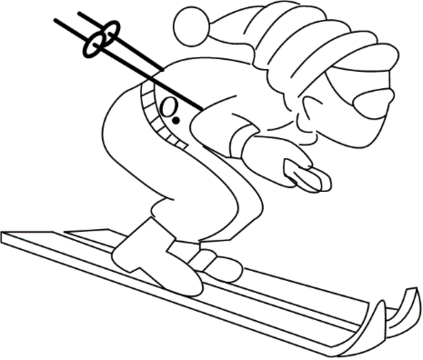

# Physics - 题目 1528

**ID**: 2792ba975c9c40c1819e5be5f56a5dda
**年级**: Grade 8
**难度**: Medium
**题型**: Drawing

## 题目
如图所示，一名滑雪爱好者沿斜面下滑，其中O为滑雪爱好者的重心，请你在图中画出爱好者受到的重力和摩擦力的示意图。​​​​​​​‌

## 解答

1. 滑雪运动员受到的重力竖直向下，沿斜面下滑时，受到的摩擦力平行于斜面向上，从运动员重心开始，分别沿各力的方向画一条有向线段，分别用G和f表示，如图所示：
2. 

## 知识点

**中文**:
  - 摩擦力的示意图
  - 重力示意图

**English**:
  - Friction Force Diagrams
  - Gravity Diagrams

---
