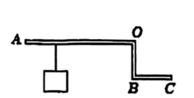
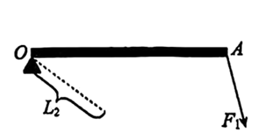

# Physics - 题目 189

**ID**: 43163d77460d490b9bdcd0b11079c556
**年级**: Grade 8
**难度**: Medium
**题型**: Drawing

## 题目
按要求完成下列作图；（1）如图所示轻质杠杆AOBC可绕O点转动，OA之间挂一重物，请作出使杠杆平衡的最小力F_{1}和阻力F_{2}的示意图。​​​​​​​‌（2）若使图中的杠杆OA保持水平位置平衡，现已画出F_{2}的力臂L_{2}，请作出力F_{2}的示意图。（3）下面是未装配好的滑轮组，请在图中画出滑轮组的绕绳方法，使用滑轮组提高重物时最省力。

## 解答

1. （1）根据杠杆平衡的条件可知，力臂越长越省力，由图知OA作为动力臂最长，过A点做OA的垂线段，方向垂直OA向上，即为动力F_{1}；阻力F_{2}是重物对杠杆的拉力，作用点在杠杆上，过阻力的作用点沿竖直向下的方向画出阻力F_{2}的示意图，如图所示：
2. 
3. （2）力臂与力的作用线垂直，若使图中的杠杆OA保持水平位置平衡，则F_{2}的方向向上，如下图所示：
4. 
5. （3）要求使用该滑轮组提升重物时最省力，则从动滑轮开始绕，绳子最后通过动滑轮向上，如图所示：
6. 

## 知识点

**中文**:
  - 力和力臂的作图
  - 杠杆中最小力的问题
  - 滑轮组的设计与组装

**English**:
  - Drawing Force and Moment Arm Diagrams
  - Minimum Force Problems in Levers
  - Design and Assembly of Pulley Systems

---
