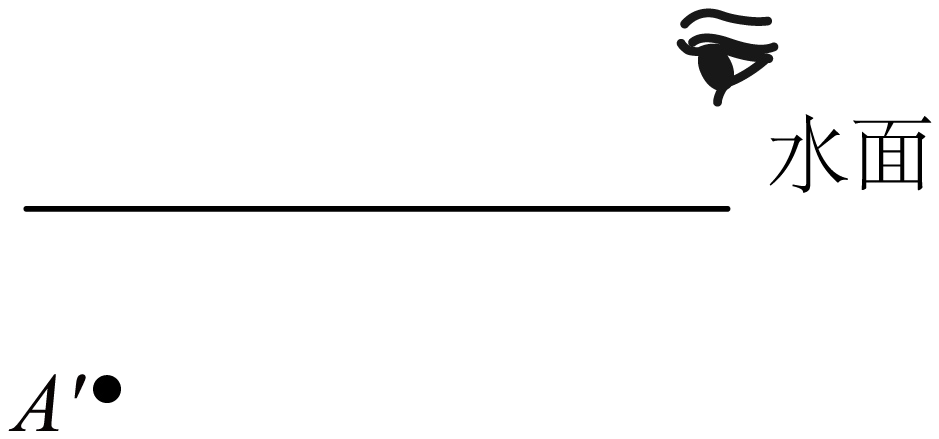

# Physics - 题目 501

**ID**: 72a28d4bc611476da0ccba94a40ccd44
**年级**: Grade 8
**难度**: Medium
**题型**: Drawing

## 题目
防溺水主题班会上，班主任提醒学生“池水看起来比实际的浅，大家切莫擅自下水”。​​​​​​​‌请画出人眼看到池底A的光路图（图中是人眼看到的池底A的像）。

## 解答

1. 当折射光线射入人眼时，人眼有光沿直线传播的经验，认为池底A在折射光线的反向延长线上的 $A^{′}$ 处，人看到的是池底A的虚像；由题可知，像在 $A^{′}$ 处，池底A在像 $A^{′}$ 的下面，眼睛在B处；先连接B、 $A^{′}$ 两点，与水面交于O点，则O为入射点；连接AO，标上箭头为入射光线，则OB为折射光线，并标上箭头，如图所示：
2. 

## 知识点

**中文**:
  - 作光的折射光路图

**English**:
  - Drawing Refraction Ray Diagrams

---
