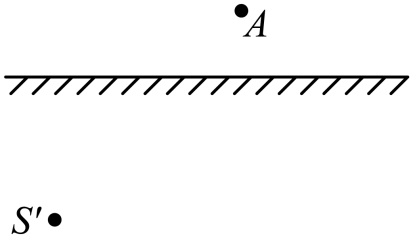

# Physics - 题目 1241

**ID**: 86c772060f5949cfb0dffa651d96784a
**年级**: Grade 8
**难度**: Medium
**题型**: Drawing

## 题目
S′是发光点S在平面镜中的像，A点是发光点S经平面镜反射后经过的一点。​​​​​​​‌请你根据平面镜成像的特点，用作图法确定发光点S的位置，并完成经A点的光路图。

## 解答

1. 平面镜成像时，像和物关于镜面对称，首先作出像点 $S^{′}$ 的对称点S，S点即为物点，连接 $AS^{′}$ ，与镜面的交点为入射点O，连接SO为入射光线，OA为反射光线，如图所示：
2. 

## 知识点

**中文**:
  - 平面镜成像的相关作图

**English**:
  - Drawing Plane Mirror Ray Diagrams

---
