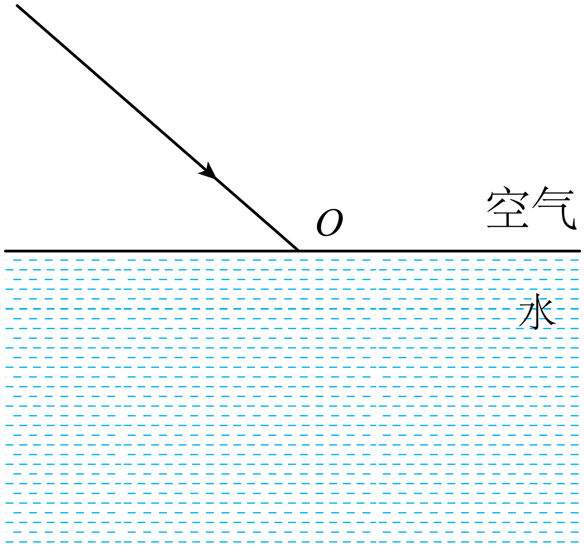
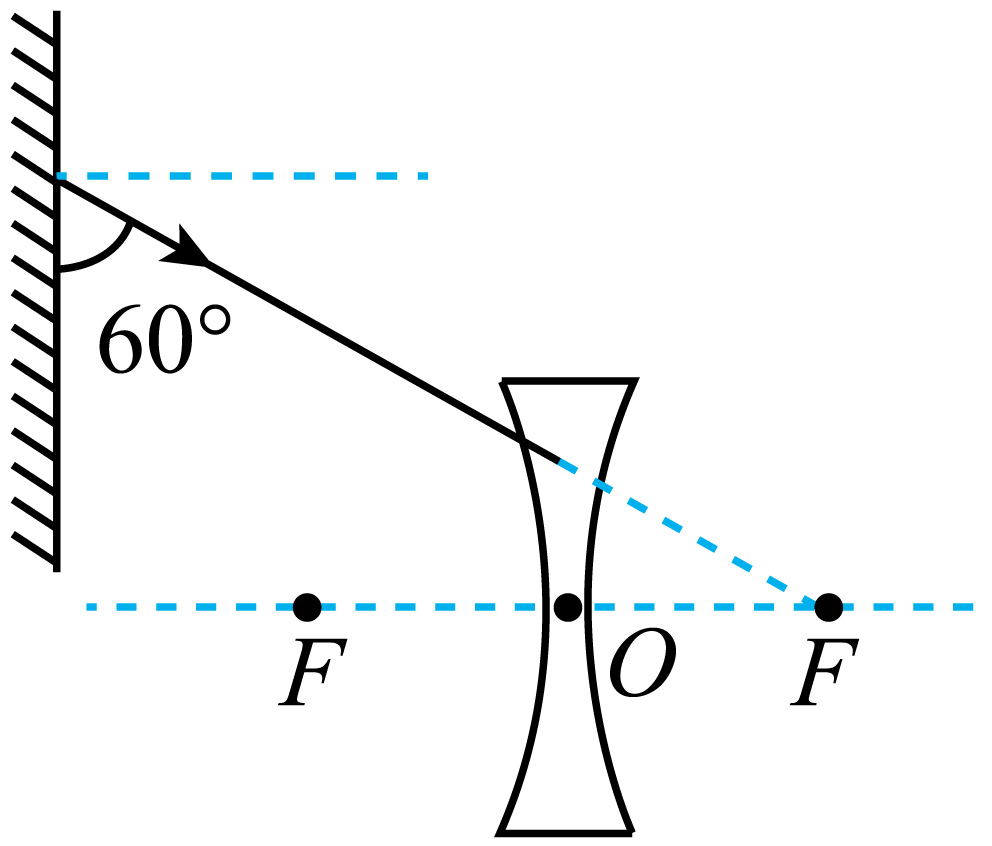

# Physics - 题目 280

**ID**: d9f4b7878b624d40b5a0466f28a64fd1
**年级**: Grade 8
**难度**: Medium
**题型**: Drawing

## 题目
（1）如图所示，一束光斜射向水面，请画出它的反射光线及折射光线的大致位置。​​​​​​​‌（2）如图所示，光线经过平面镜反射后射向凹透镜，请画出射向平面镜的入射光线和经过凹透镜后的折射光线。

## 解答

1. （1）一束光斜射向水面，在水面同时发生反射和折射，先过入射点O垂直于水面画出法线，再根据在光的反射现象中反射角等于入射角，画出反射光线，根据折射规律，当光从空气斜射入水中时，折射角小于入射角，画出折射光线，如图所示：
2. 
3. （2）光线先经过平面镜反射，根据在光的反射现象中反射角等于入射角，画出入射光线，反射光线的延长线过凹透镜的虚焦点，故其折射光线与主光轴平行，如图所示：
4. 

## 知识点

**中文**:
  - 作透镜的光路图
  - 光学综合作图

**English**:
  - Drawing Ray Diagrams for Lenses
  - Comprehensive Optical Drawing

---
