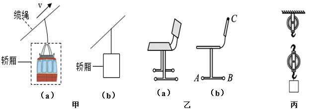

# Physics - 题目 2211

**ID**: e3cbbc64eba049edb3a7cfb8a5b3e951
**年级**: Grade 8
**难度**: Medium
**题型**: Drawing

## 题目
按要求作图：（1）如甲图（a）所示，空缆车随缆绳做匀速直线运动，在甲图（b）中画出缆车的轿厢（以方框表示）受力示意图（不计空气阻力）。​​​​​​​‌（2）如乙图（a）是教室里的学生座椅，乙图（b）是它的侧面图，要在C点用最小的力F使座椅绕A开始逆时针转动，请在乙图（b）中画出：F的示意图及F的力臂l。（3）请在丙图中画出使用滑轮组提升物体时，最省力的绳子绕法。

## 解答

1. （1）空缆车随缆绳做匀速直线运动，轿厢受竖直向下的重力和竖直向上的拉力处于平衡状态，拉力和重力大小相等，作用点在轿厢上，如图所示：
2. 
3. （2）图中A为支点，连接AC，以AC作为该力的力臂时，力臂最长，力最小，由题意可知，要在C点用最小的力F使座椅绕A开始逆时针转动，则动力应垂直于力臂L向左，据此可画出最小动力F的示意图；如图所示：
4. 
5. （3）用滑轮组提升重物时，动滑轮上承载的绳子的段数越多越省力，如图所示：
6. 

## 知识点

**中文**:
  - 力和力臂的作图
  - 弹力和重力作图
  - 杠杆中最小力的问题
  - 滑轮组的设计与组装

**English**:
  - Drawing Force and Moment Arm Diagrams
  - Drawing Elastic and Gravity Force Diagrams
  - Minimum Force Problems in Levers
  - Design and Assembly of Pulley Systems

---
