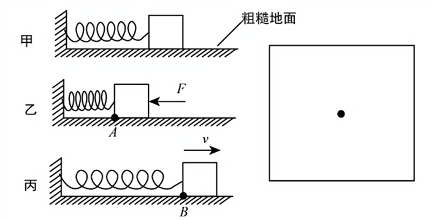

# Physics - 题目 1569

**ID**: e6b227f1ffeb435e884090b6da32ca8d
**年级**: Grade 8
**难度**: Medium
**题型**: Drawing

## 题目
轻质弹簧一端固定在墙上，另一端固定在一物块上，如图甲所示，此时弹簧处于正常状态，弹簧与物块之间没有弹力；用力F把物块向左推至A点，弹簧被压缩，如图乙所示；撤去推力F，物块向右运动。​​​​​​​‌当物块运动到图丙中B点的位置时，速度为v，弹簧被拉伸，请在方框内以点代替物块，画出物块在B点时的受力示意图。

## 解答

1. 当物块运动到图丙中B点的位置时，速度为v弹簧被拉伸，此时弹簧对物块的拉力的方向是水平向左的，由于物体向右运动，则桌面对物体的摩擦力的方向是水平向左的；在竖直方向上受到重力和支持力的作用，大小相等，方向相反，这两个力是一对平衡力，所以物体一共受到4个力的作用，如图
2. 

## 知识点

**中文**:
  - 摩擦力、平衡力和非平衡力作图

**English**:
  - Drawing Friction, Equilibrium, and Non-Equilibrium Forces

---
