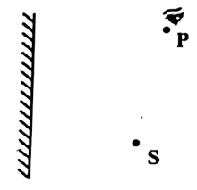

# Physics - 题目 697

**ID**: f7106d2c071b489a9421b33b66cc967e
**年级**: Grade 8
**难度**: Medium
**题型**: Drawing

## 题目
如图所示，S点为平面镜前跳棋子的位置，P为人眼的位置，请在图中完成人眼在P点看到跳棋子的光路图。​​​​​​​‌

## 解答

1. 先作出S点关于平面镜的对称点 $S{^{^{′}}}$ ，连接 $S{^{^{′}}}P$ 与镜面的交点O即为反射点，连接 $SO$ 即为入射光线， $OP$ 即为反射光线，故作图如下：
2. 

## 知识点

**中文**:
  - 平面镜成像的相关作图

**English**:
  - Drawing Plane Mirror Ray Diagrams

---
