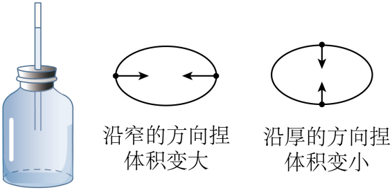

# Physics - 题目 557

**ID**: 334ad25122b9417c9fcd63cbc441baf3
**年级**: Grade 8
**难度**: Medium
**题型**: 课后习题

## 题目
如图，将椭圆形厚玻璃瓶装满水，把细玻璃管通过带孔的橡皮塞插入瓶中。​​​​​​​‌沿着不同的方向用力捏厚玻璃瓶，观察细管中水面高度的变化。请你从力使物体产生形变的角度解释所看到的现象。

## 解答

1. 在图中，把细玻璃管通过带孔的橡皮塞插入瓶中，若沿着椭圆窄的方向用力捏厚玻璃瓶，玻璃瓶变圆、容积变大，而水的体积一定，则细管中水面高度会下降；若沿着椭圆宽的方向用力捏厚玻璃瓶，玻璃瓶变扁、容积变小，则细管中水面高度会上升。

## 知识点

**中文**:
  - 力的作用效果

**English**:
  - Effects of Force

---
