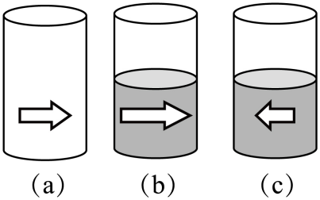

# Physics - 题目 1449

**ID**: 05aeaf614c144b7db7f689618cb251e8
**年级**: Grade 8
**难度**: Medium
**题型**: Experiment

## 题目
如图（a）所示，一个圆柱形玻璃杯，其后面画有“”的白纸板竖直放置在水平面上。​​​​​​​‌某同学将盛有水的玻璃杯放在该纸板前，现象如图（b）所示，随后将玻璃杯向远离白纸板的方向移动一段距离，观察到的现象如图（c）所示。（1）请描述你通过图（b）玻璃杯看到的箭头与图（a）有何不同；（2）请描述你通过图（c）玻璃杯看到的箭头与图（a）、图（b）有何不同；（3）根据上述描述进行合理的猜想：你通过玻璃杯看到的箭头的大小或方向可能与有关。

## 解答

1. （1）图（b）玻璃杯看到的箭头比图（a）中箭头大。
2. （2）玻璃杯和白纸板的距离变化，图（c）玻璃杯看到的箭头不但比图（a）、图（b）的箭头小，且方向相反
3. （3）改变玻璃板和纸板之间的距离，箭头的大小或方向改变，猜想：通过玻璃杯看到的箭头的大小或方向可能与白纸板上箭头到玻璃杯的距离有关。

## 知识点

**中文**:
  - 科学探究过程及实验方法

**English**:
  - Scientific Inquiry Process and Experimental Methods

---
