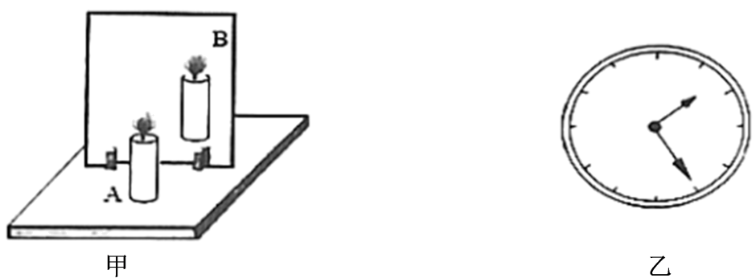

# Physics - 题目 596

**ID**: 0661f58a87264bcb9e1d2978638f3436
**年级**: Grade 8
**难度**: Medium
**题型**: Experiment

## 题目
小丽用如图甲所示装置探究“平面镜成像的特点”。​​​​​​​‌（1）实验中，在水平桌面的白纸上放置一块玻璃板作为平面镜，主要是利用玻璃板透明的特点，便于。（2）把一支点燃的蜡烛A竖直立在玻璃板前面，再拿一支外形完全相同未点燃的蜡烛B竖直立在玻璃板后面移动，直到看上去它跟完全重合。（3）小丽移开后面的蜡烛B，用白纸作为光屏放在像的位置，然后（填“透过”或“不透过”）玻璃板观察白纸，此时白纸上承接不到蜡烛A的像，说明平面镜成的是像。（4）在探究像与物到平面镜距离的关系时，为了得到普遍规律，你对她接下来的操作建议是，多做几组实验。（5）实验结束后，小明无意间从平面镜中看到墙上的电子钟的像如图乙所示，这时的时间是。

## 解答

1. （1）  实验中，在水平桌面的白纸上竖直放置一块玻璃板作为平面镜，主要是利用玻璃板透明的特点，便于观察像并确定像的位置。
2. （2） 把一支点燃的蜡烛A竖直立在玻璃板前面，再拿一支外形完全相同未点燃的蜡烛B竖直立在玻璃板后面移动，直到看上去它跟A蜡烛的像完全重合。此现象表明平面镜所成像的大小与物体的大小相等。
3. （3） 在探究平面镜成的像是虚像还是实像时，小欣移开后面的蜡烛，用白纸做光屏放在像的位置，若成实像，则能在对侧白纸上看到，若成虚像则不能，故要不透过玻璃板观察白纸，此时将看不到蜡烛A的像，说明平面镜成的是虚像。
4. （4） 在探究像与物到平面镜距离的关系时，为了得到普遍规律，你对她接下来的操作建议是改变蜡烛A到玻璃板的距离，多做几组实验。
5. （5） 根据像物关于镜面对称的性质，在平面镜中的像与现实中的事物恰好左右颠倒，且关于镜面对称，分析可得：图中显示的时间10∶35。

## 知识点

**中文**:
  - 平面镜成像特点的探究实验

**English**:
  - Experiment: Characteristics of Plane Mirror Imaging

---
