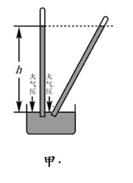
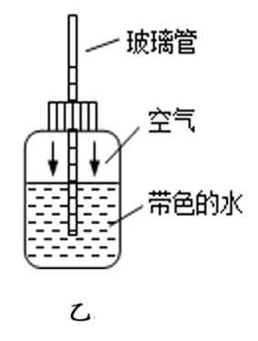

# Physics - 题目 872

**ID**: 07937609ffbc4c12887729d10860e3ea
**年级**: Grade 8
**难度**: Medium
**题型**: Experiment

## 题目
如图甲和乙分别是托里拆利实验和自制的水气压计装置：（1）在托里拆利实验装置中，玻璃管内的上方是，玻璃管外水银面的上方是空气，因此在的作用下管内的水银柱不会下落。​​​​​​​‌（2）实验中，若将玻璃管如图倾斜，则玻璃管内水银柱的竖直高度；若当大气压减小时，会发现甲装置中的水银柱竖直高度。（均选填“上升、不变、下降”）（3）图乙装置是小雨和小明自制的气压计，当将此装置从山下移到山顶，则细管中的水柱（选填“上升、不变、下降”）；发生这一变化的原因是。

## 解答

1. （1）利用托里拆利实验装置测量大气压时，开始要在水银管内灌满水银，这样可以将管内空气全部排出，保证管内水银上方为真空；玻璃管外水银面的上方是空气，玻璃管内水银柱不会落下是靠大气压支持。
2. （2）将玻璃管倾斜一些，大气压不变，水银柱高度也不变。
3. 当大气压减小时，大气压能支持的管内外水银柱液面的高度差将逐渐变小，会发现甲装置中的水银柱下降。
4. （3）当将此装置从山下移到山顶，海拔变高了，则外界的气压减小，液面在内部气压的作用下会上升。

## 知识点

**中文**:
  - 大气压强的测量及标准大气压

**English**:
  - Measurement of Atmospheric Pressure & Standard ATM

---
