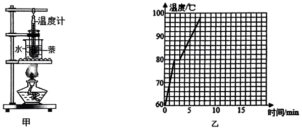

# Physics - 题目 145

**ID**: 0ae039f048bb40c087ffde7cf0e65e4a
**年级**: Grade 8
**难度**: Medium
**题型**: Experiment

## 题目
用如图甲所示装置探究萘熔化时温度的变化规律。​​​​​​​‌请回答下列问题：（1）除如图甲所示实验器材外，还需要的实验器材有火柴和；（2）将装有萘的试管放入水中加热，俗称水浴法。水浴法加热时，大烧杯中应装有适量的水，其中的“适量”指的是；（3）萘加热一段时间后，可看到烧杯中有“白气”冒出，“白气”是（填序号）；

## 解答

1. （1）实验中，需要记录温度随时间的变化情况，因此需要秒表来记录时间。
2. （2）水浴法加热时，大烧杯中的水应适量，水要既可以浸没试管中的固体，且放入试管后烧杯内水不溢出，试管底不触碰烧杯底。
3. （3）白气是温度较高的水蒸气遇冷液化形成的小水珠。
4. 故选B。
5. （4）实验中要记录不同时间段萘的状态，故表格中（b）处应填写“状态”。
6. （5）A．降低萘的初始温度，不能增加奈的恒温时间，故A不符合题意；
7. B．用底面积更大的小烧杯代替试管做实验，损失的热量更少，萘熔化的时间会更短，恒温的时间更短，故B不符合题意；
8. C．增加萘的质量，萘熔化时吸收的热量增多，加热时间延长，可以增长萘的恒温时间，故C符合题意。
9. （6）通过实验可以得出萘熔化的条件是：达到一定的熔化温度，即温度达到熔点，且继续吸热。

## 知识点

**中文**:
  - 熔化和凝固的探究实验

**English**:
  - Experiment: Melting and Solidification

---
