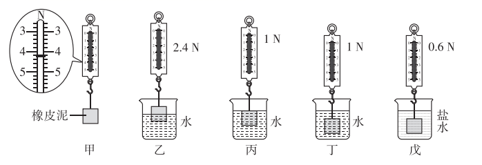

# Physics - 题目 979

**ID**: 0c4289f728a046ae81951ab74cc3f738
**年级**: Grade 8
**难度**: Medium
**题型**: Experiment

## 题目
某小组在做“探究影响浮力大小的因素”实验，实验器材有弹簧测力计，橡皮泥、两个相同的烧杯（分别装有水和盐水），实验步骤如图所示。​​​​​​​‌（l）分析图乙，此时橡皮泥在水中所受的浮力F=N；（2）分析图可知，浮力大小与物体浸没在液体中的深度无关；（3）分析图甲，丁、戊，可以得出结论：；（4）在上述实验的基础上，小组同学还想探究“浮力的大小是否与物体的形状有关”请你写出合理的操作方法：。

## 解答

1. （1）由图甲可知，物体重力
2. $G{\rm{=}}4.2{\rm{N}}$
3. 乙图中，此时橡皮泥在水中所受的浮力
4. F=G-F_{示}=4.2N-2.4N=1.8N
5. 此时橡皮泥在水中所受的浮力为1.8N。
6. （2）图丙、丁中，物体浸没在液体中的深度不同，而弹簧测力计的示数相同，则物体受到的浮力相同，说明浮力大小与物体浸没在液体中的深度无关。
7. （3）丁、戊两图中，物体浸入液体中的体积相同，盐水密度大于水，物体在盐水中受到的浮力大于在水中受到的浮力，说明浸在液体中的体积一定时，液体密度越大，浮力越大。
8. （4）要探究“浮力的大小是否与物体的形状有关”需要控制物体浸在液体中的体积，和液体密度相同，只改变物体形状，比较物体受到的浮力大小。合理的操作方法是，将橡皮泥捏成不同的形状后浸没在水中，比较弹簧测力计示数的大小。

## 知识点

**中文**:
  - 探究影响浮力大小因素的实验

**English**:
  - Experiment: Factors Affecting Buoyancy

---
