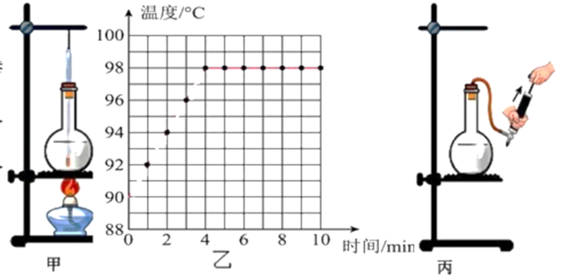

# Physics - 题目 978

**ID**: 0c7d425df7ce46efb72b4d85ce678935
**年级**: Grade 8
**难度**: Medium
**题型**: Experiment

## 题目
小京探究水在沸腾前后温度变化的特点，用下图甲所示的装置给一定质量的水加热，当水温达到90℃时，每隔1min记录一次水的温度，水沸腾后持续加热一段时间，并记录水的温度。​​​​​​​‌根据实验数据得到了水的温度随加热时间变化的关系图像，如图乙所示。（1）组装器材时应先放（选填“酒精灯”或“温度计”）；（2）水的沸腾是一种表面和内部同时发生的剧烈的（填物态变化名称）现象；（3）由图乙可知烧杯中水的沸点是℃；（4）水沸腾后，小京移开酒精灯后，过一会儿水不再沸腾，说明水沸腾时要（选填“吸收”或“放出”）热量；（5）水停止沸腾后小京用抽气筒抽出烧瓶中的一部分气体，如图丙所示，发现水再次沸腾，说明气压降低，水的沸点变（选填“高”或“低”）。

## 解答

1. （1）使用酒精灯加热时，要用外焰加热，所以要根据酒精灯火焰的高度确定烧杯的高度，故组装装置时，要按照自下而上的顺序，即先放酒精灯。
2. （2）汽化是物体从液态转化为气态的过程，沸腾是一种表面和内部同时发生的剧烈的汽化现象。
3. （3）水在沸腾时温度保持不变，该温度即为水的沸点，由图可知，实验测得水的沸点为98℃。
4. （4）水在沸腾时虽然温度保持不变，但要持续吸热，若移开酒精灯，过一会儿水不再沸腾。
5. （5）水的沸点受大气压强的影响，气压越低，水的沸点越低，所以用抽气筒抽出烧瓶中的一部分气体，烧瓶内气压减小，水的沸点降低，发现水再次沸腾。

## 知识点

**中文**:
  - 探究水的沸腾实验

**English**:
  - Experiment: Boiling of Water

---
