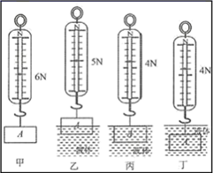

# Physics - 题目 2733

**ID**: 123993388312449c8f38e8561adafdb1
**年级**: Grade 8
**难度**: Medium
**题型**: Experiment

## 题目
某兴趣小组在探究浸在液体中的物体所受浮力大小规律的实验中，做了如图所示的实验，将同一物体A逐渐浸入到密度的液体中，并通过观察弹簧测力计的示数的变化规律，得出以下一些结论：（1）分析比较实验序号甲、乙、丙可初步得出结论：当液体的密度相同时，物体排开液体的体积越大，物体受到的浮力越，分析比较实验序号可初步得出结论：当排开液体的体积相同时，物体所受浮力与浸没在液体中的深度（选填“有关”或“无关”）；（2）由实验可知A物体的重力为N，A物体浸没在液体中所受的浮力是N。​​​​​​​‌

## 解答

1. （1）分析比较实验序号甲、乙、丙，液体的密度相同时，物体排开液体的体积越大，弹簧测力计的示数越小，根据F_{浮}=G﹣F_{示}，物体受到浮力越大；
2. 研究物体所受浮力与物体浸没在液体中的深度的关系时，应控制排开液体的体积和液体的密度相同，改变物体A在液体的深度，所以，应分析比较实验序号甲、丙、丁。
3. 已知在丙、丁中，弹簧测力计的示数均为4N，根据F_{浮}=G﹣F知，物体受到的浮力不变。可初步得出结论：当排开液体的体积相同时，物体所受浮力与浸没在液体中的深度无关。
4. （2）由甲图知，A物体的重力为6N，A物体浸没时，弹簧测力计的示数为4N，由F_{浮}=G﹣F得：A物体浸没在液体中所受的浮力大小为2N。

## 知识点

**中文**:
  - 探究影响浮力大小因素的实验

**English**:
  - Experiment: Factors Affecting Buoyancy

---
