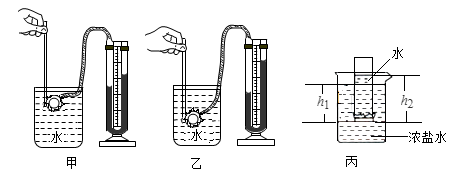

# Physics - 题目 1230

**ID**: 14168d27297f418bb6a621465801892f
**年级**: Grade 8
**难度**: Medium
**题型**: Experiment

## 题目
同学们利用压强计等装置“探究液体内部压强”的规律，进行了如下的操作：（1）为了使实验现象更明显，U形管中的液体最好用的（选填“有色”或“无色”）；（2）正确操作后，分析甲、乙两图的实验现象，初步得出的结论是：同种液体中，液体压强随液体深度的增加而，因此拦河大坝要做成的形状（选填“上窄下宽”或“上宽下窄”）；（3）小明保持乙图中探头的位置不变，并向容器内加入适量的浓盐水，搅拌均匀后，他发现U形管两侧液面的高度差又变大了，于是得出了“在同一深度，液体的密度越大，其内部的压强越大”的结论。​​​​​​​‌他的操作是错误的，原因是加入盐水后液面位置改变了，正确操作是应将探头适当（选填“上移”或“下移”）；（4）聪明的小明还想知道浓盐水密度是多少，于是找来刻度尺、两端开口的玻璃管、橡皮膜和水（密度用ρ_{水}表示）等器材测浓盐水的密度，操作步骤如下：a．将一端蒙上橡皮膜的玻璃管缓慢插入装有浓盐水的烧杯中，测出管底到浓盐水液面的高度为h_{1}；b．往玻璃管中加水，直到橡皮膜的表面没有凹凸时，用刻度尺测出玻璃管中水柱的高度为h_{2}。用小明测得的物理量可推导出盐水密度的表达式为ρ_{盐}_{水}=（结果用ρ_{水}、h_{1}、h_{2}表示）。

## 解答

1. （1）[1] U形管中的液体最好用有色的，容易观察液面高度差。
2. （2）[2][3]深度越深，液面高度差越大，液体内部的压强大，故结论是同种液体中，液体压强随液体深度的增加而增加；随着深度的加大，液体压强变大，故拦河大坝要做成上窄下宽。
3. （3）[4]加入盐水后液面变高了，深度变大，故需要将压强计上移，保证深度相同。
4. （4）[5]橡皮膜的表面没有凹凸时，则内外压强相同，故可以列等式
5. $p{{}_{水}}=ρ{{}_{水}}gh{{}_{2}}{\rm{=}}p{{}_{盐}}=ρ{{}_{盐水}}gh{{}_{1}}$
6. 经整理可得
7. $ρ{{}_{盐水}}{\rm{=}}\frac {ρ{{}_{水}}h{{}_{2}}}{h{{}_{1}}}$
8. 故盐水密度的表达式为 $\frac {ρ{{}_{水}}h{{}_{2}}}{h{{}_{1}}}$ 。

## 知识点

**中文**:
  - 探究液体压强的特点实验

**English**:
  - Experiment: Characteristics of Liquid Pressure

---
