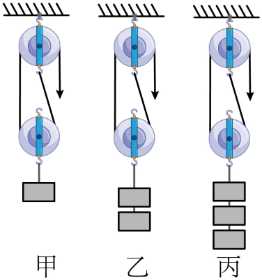

# Physics - 题目 399

**ID**: 14ee18a3189145ab862832f5d113d188
**年级**: Grade 8
**难度**: Medium
**题型**: Experiment

## 题目
在“测量滑轮组的机械效率”实验中，小陈用如图所示的同一滑轮组提升不同重力的物体，将弹簧测力计悬挂绳子的自由端，实验数据记录如表所示：实验次数123物体所受的重力G/N6.012.018.0提升高度h/m0.10.10.1拉力F/N6.09.613.2绳端移动的距离s/m0.20.20.2机械效率η50.0%62.5%A(1)实验中要竖直向下拉动弹簧测力计，使物体升高；(2)表格中编号A处数据应为；分析表中实验数据可以得出如下结论：同一滑轮组提升不同重物时，被提升的物体重力越大，滑轮组的机械效率越；(3)小陈同学通过计算还发现，此滑轮组提升不同重力的物体时，绳子重力和摩擦力所对应的额外功与总功的比值总等于 $\frac {1}{6}$ ，则动滑轮的重力为N。​​​​​​​‌

## 解答

1. （1）实验中要竖直向下匀速缓慢拉动弹簧测力计，使物体匀速上升，由二力平衡条件可知，测力计示数等于拉力大小。
2. （2）由表中数据可得，第3次实验的机械效率： $η=\frac {W{{}_{有}}}{W{{}_{总}}}\times 100\%=\frac {Gh}{Fs}\times 100\%=\frac {18{\rm{N}}\times 0.1{\rm{m}}}{13.2{\rm{N}}\times 0.2{\rm{m}}}\times 100\%=68.2\%$ ，由表中数据可知，使用同一滑轮组提升物体的重力越大，滑轮组的机械效率越大，所以可以得出结论：同一滑轮组提升不同重物时，被提升的物体重力越大，滑轮组的机械效率越高。
3. （3）根据第1次实验数据可知，有用功W_{有}=Gh=6.0N×0.1m=0.6J，总功W_{总}=Fs=6.0N×0.2m=1.2J，克服动滑轮做的功W_{动}=G_{轮}h=G_{轮}×0.1m，则绳重和摩擦导致的额外功W_{额}=W_{总}-W_{有}-W_{动}=1.2J-0.6J-G_{轮}×0.1m=0.6J-G_{轮}×0.1m，绳重和摩擦导致的额外功与总功的比值 $k=\frac {0.6{\rm{J}}-G{{}_{动}}\times 0.1{\rm{m}}}{1.2{\rm{J}}}=\frac {1}{6}$ ，解得G_{轮}=4N

## 知识点

**中文**:
  - 滑轮（组）的机械效率的测量实验

**English**:
  - Experiment: Measuring Mechanical Efficiency of Pulleys

---
