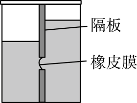

# Physics - 题目 2355

**ID**: 15c276622c6b4252957887e037cc55df
**年级**: Grade 8
**难度**: Medium
**题型**: Experiment

## 题目
小亚用如图所示装置测量盐水的密度，已知容器中间用隔板分成两部分，隔板下部有一圆孔用薄橡皮膜封闭，在容器左侧注入盐水，右侧注入水。​​​​​​​‌（1）当注入的盐水和水的深度相同且均为h_{1}时，水产生的压强（选填“大于”、“小于”或“等于”）盐水产生的压强，橡皮膜向（选填“左”或“右”）凸，说明液体压强与有关；（2）继续向右侧注入水，若此时水的深度为h_{2}，盐水深度保持h_{1}不变时，使橡皮膜的形状不变时，橡皮膜左右两侧受到的压强，说明液体压强与有关；（3）测到盐水的密度为ρ_{盐}_{水}=（已知ρ_{盐}_{水}用测得量的符号表示）。

## 解答

1. （1）[1][2][3]当注入的盐水和水的深度相同且均为h_{1}时，可以观察到实验中的橡皮膜向右凸起，说明左侧的盐水产生的压强更大，这个现象说明，液体深度相同时，密度大的液体内部压强更大，所以液体压强与液体密度有关。
2. （2）[4][5]继续向右侧注入水，若此时水的深度为h_{2}，盐水深度保持h_{1}不变，使橡皮膜的形状不变。橡皮膜的形状不发生变化说明橡皮膜两侧的压强相同，此时深度更深的水产生的压强与浅的盐水压强相同，说明液体压强还与液体深度有关。
3. （3）[6]此时水的深度为h_{2}，盐水深度保持h_{1}不变，两种液体压强相同，则有
4. $ρ{{}_{盐水}}gh{{}_{1}}=ρ{{}_{水}}gh{{}_{2}}$
5. 解得盐水密度
6. $ρ{{}_{盐水}}=\frac {h{{}_{2}}}{h{{}_{1}}}ρ{{}_{水}}$

## 知识点

**中文**:
  - 探究液体压强的特点实验

**English**:
  - Experiment: Characteristics of Liquid Pressure

---
