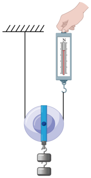

# Physics - 题目 1391

**ID**: 1796982e8fcc4122acae4d18dff5894b
**年级**: Grade 8
**难度**: Medium
**题型**: Experiment

## 题目
小明用如图所示的装置测量动滑轮的机械效率。​​​​​​​‌序号动滑轮重力G_{动}/N钩码重G/N钩码上升的高度h/m绳端的拉力F/N绳端移动的距离s/m机械效率η①0.110.10.60.283.3%②0.120.11.10.290.9%③0.220.11.20.2（1）实验时，应竖直向上拉动弹簧测力计，使挂在动滑轮下面的钩码缓慢上升，测得的实验数据如表格所示。（2）请补充表格中的空格。（3）根据表格中的数据可知，动滑轮重一定时，越重，机械效率越大。（4）根据表格数据可得  $F>\frac {1}{2}(G{{}_{动}}+G)$ ，可能的原因是（答出一种即可）。（5）实验序号①中，若用手竖直向上提弹簧测力计使钩码处于静止状态时，读出拉力数值进行计算，则机械效率将（选填“大于”、“小于”或“等于”）83.3%。

## 解答

1. （1）[1]测量滑轮组机械效率时，缓慢匀速竖直向上拉动弹簧测力计，以保持弹簧测力计示数稳定。
2. （2）[2]钩码重 $G{\rm{=}}2{\rm{N}}$ ，拉力 $F=1.2{\rm{N}}$ ,连接动滑轮绳子的段数 $n=2$ ，则机械效率
3. $η=\frac {G}{nF}=\frac {{\rm{2}}{\rm{N}}}{{\rm{2}}\times {\rm{1}}{\rm{.}}{\rm{2}}{\rm{N}}}\approx 83.3\%$
4. （3）[3]根据①②的数据可知，动滑轮重力一定时，钩码越重，机械效率越大。这里需要运用控制变量的方法。
5. （4）[4]当忽略绳子的重力和系统所有的摩擦时，拉力 $F{\rm{=}}\frac {1}{2}(G{{}_{动}}+G)$ ，此处 $F>\frac {1}{2}(G{{}_{动}}+G)$ ，则可能是由于绳子的重力或滑轮组存在摩擦导致的。
6. （5）[5]在实际测量动滑轮的机械效率时，绳子和滑轮间的摩擦以及滑轮与轴之间的摩擦力是不可忽略的，在向上运动的过程中需要克服摩擦力做功，而静止时则不需要克服摩擦力做功，这部分额外功被省略了，额外功减小则总功减小，有用功不变，根据 $η=\frac {W{{}_{有}}}{W{{}_{总}}}$  可得，静止时测得的机械效率更大。

## 知识点

**中文**:
  - 滑轮（组）的机械效率的测量实验

**English**:
  - Experiment: Measuring Mechanical Efficiency of Pulleys

---
