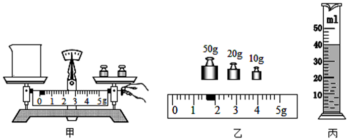

# Physics - 题目 2392

**ID**: 2633a79bed154d198fdfa5f395690775
**年级**: Grade 8
**难度**: Medium
**题型**: Experiment

## 题目
小明妈妈为家里自酿了很多葡萄酒，小明想知道自酿葡萄酒的密度，于是和学习小组的同学们一起利用天平、量筒进行测量。​​​​​​​‌他们的操作如下，请你帮他们解决实验中遇到的问题：(1)将天平放在上，游码拔至标尺处，并调节天平平衡；(2)用天平测量空烧杯的质量，如图甲是小明测量过程中的情景，他的错误是，纠正错误后，测量空烧杯的质量是41.6g；(3)取适量的葡萄酒倒入烧杯中，用天平测葡萄酒和烧杯的总质量，天平平衡时，右盘中砝码及游码的位置如图乙所示，其总质量是g；(4)将烧杯中的葡萄酒全部倒入量筒中（如图丙所示），量筒中的葡萄酒的体积是cm^{3}，根据测量数据计算出葡萄酒的密度是kg/m^{3}；(5)分析上述方法，测出葡萄酒的密度会偏（选填“大”或“小”），理由是。

## 解答

1. (1)[1][2]测量前，应把天平放到水平工作台上，游码移到标尺左端的零刻度线，通过平衡螺母调节横梁平衡。
2. (2)[3]在测量过程中不能调节平衡螺母，应调节游码。
3. (3)[4]用天平称量葡萄酒和的总质量时，砝码总质量
4. 50g+20g+10g=80g
5. 游码对应的刻度值是1.6g，所以读数为
6. 80g+1.6g=81.6g
7. 故葡萄酒和的总质量为81.6g。
8. (4)[5]由甲图知，量筒的分度值为5mL，所以葡萄酒的体积为40mL，
9. 葡萄酒的质量
10. m=m_{总}-m_{剩}=81.6g-41.6g=40g
11. [6]葡萄酒的密度
12. $ρ=\frac {m}{V}{\rm{=}}\frac {{\rm{4}}{\rm{0}}{\rm{g}}}{{\rm{4}}{\rm{0}}{\rm{c}}{\rm{m}}{^{{\rm{3}}}}}{\rm{=}}{\rm{1}}{\rm{g}}{\rm{/}}{\rm{c}}{\rm{m}}{^{{\rm{3}}}}{\rm{=}}{\rm{1}}\times {\rm{1}}{\rm{0}}{^{{\rm{3}}}}{\rm{k}}{\rm{g}}{\rm{/}}{\rm{m}}{^{{\rm{3}}}}$
13. (5)[7]当将烧杯中的葡萄酒倒入量筒中时，烧杯壁上会附着着一定量的葡萄酒，从而使体积测量的数值偏小，这样得出的密度值就偏大。

## 知识点

**中文**:
  - 液体密度的测量实验

**English**:
  - Experiment: Measuring Density of Liquids

---
