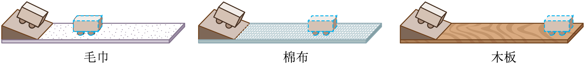

# Physics - 题目 1703

**ID**: 2d4400899a6e4bf99109a878986c6084
**年级**: Grade 8
**难度**: Medium
**题型**: Experiment

## 题目
在“探究阻力对物体运动的影响”的实验中，让小车由静止开始沿斜面滑下，小车在不同水平面上运动一段距离后分别停在如图所示的位置。​​​​​​​‌（1）实验中每次均让同一辆小车从同一斜面的同一高度由静止自由下滑，目的是使小车到达水平面时具有，小车在水平面上滑行的距离就只跟小车受到的有关。（2）小车在水平面上运动时，受到的重力和水平面对小车的支持力（是/不是）一对平衡力。（3）实验得出初步结论是：水平面的粗糙程度越小，小车受到的阻力，小车滑行的距离就。（4）根据实验现象可以推断：在水平面上运动的小车，如果受到的阻力为零，小车将做运动。（5）牛顿第一定律是建立在（      ）（选填序号）

## 解答

1. （1）每次都让同一小车从斜面的同一高度由静止自由滑下，目的是使小车到达水平面时具有相同的初速度。
2. 实验中通过改变接触面的粗糙程度来改变小车所受阻力的大小，接触面越粗糙，小车所受到的阻力越大。
3. （2）小车进入水平面后，水平方向做减速运动，受力不平衡，竖直方向上受到的重力和支持力大小相等、方向相反、作用在同一直线上、作用在同一物体上，是一对平衡力。
4. （3）由实验现象可知，毛巾表面粗糙程度最大，小车所受的摩擦力最大，小车滑行的距离最短，速度减小得最快；木板表面粗糙程度最小，小车所受的摩擦力最小，小车滑行的距离最远，速度减小得最慢；可得出：平面粗糙程度越小，小车受到的摩擦力越小，滑行的距离越远，速度减小得越慢。
5. （4）根据实验现象，可推理得出：运动的小车如果所受的阻力为零，没有力改变小车的运动状态，因此小车的运动状态不改变，小车将做匀速直线运动。
6. （5）绝对光滑的平面并不存在，无法直接探究光滑平面小车的运动情况，牛顿第一定律是建立在实验和科学推理相结合的基础上的，故A、B、C不符合题意，D符合题意。

## 知识点

**中文**:
  - 阻力对物体运动影响的探究实验

**English**:
  - Experiment: Effect of Resistance on Motion

---
