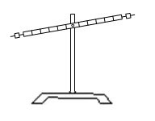

# Physics - 题目 1476

**ID**: 30efdbb90fe3472cbf1d00f421d908b6
**年级**: Grade 8
**难度**: Medium
**题型**: Experiment

## 题目
小华同学通过实验探究杠杆平衡的条件，所用实验器材有、细线（弹簧夹）、、钩码和铁架台。​​​​​​​‌小华同学发现杠杆的右端翘起，如图所示，杠杆（选填“是”或“不是”）处于平衡状态。杠杆两端的螺母作用是：，此实验杠杆需在位置平衡，其目的是为了便于。

## 解答

1. [1][2]由题意知，要研究杠杆平衡的条件，需要带刻度的均匀杠杆，还要测力与力臂的关系，因此用到弹簧测力计。
2. [3]杠杆静止在如图所示位置，杠杆处于静止状态，所以此时杠杆处于平衡状态。
3. [4][5][6]实验前杠杆不平衡，可调节两端的平衡螺母，使杠杆在水平位置平衡，调节杠杆的水平平衡是为了便于测量力臂。

## 知识点

**中文**:
  - 探究杠杆的平衡条件实验

**English**:
  - Experiment: Equilibrium Conditions of Levers

---
