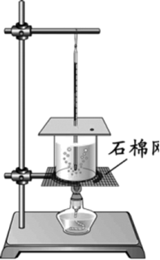

# Physics - 题目 1163

**ID**: 314f49231ff54c4bb7a93d7d55f29504
**年级**: Grade 8
**难度**: Medium
**题型**: Experiment

## 题目
小阳用如图所示的装置探究水沸腾过程中温度随加热时间变化的特点，他记录的实验数据如表所示。​​​​​​​‌（1）小阳应通过观察判断水是否沸腾；（2）请你根据表中的数据归纳实验结论：；（3）停止用酒精灯加热后，水并没有立即停止沸腾，原因可能是；加热时间/min00.511.522.53温度/℃90939699999999（4）在标准大气压下，沸水的温度为100℃，但本次实验中水的沸点却低于100℃。检查发现读数正确。请分析出一个可能的原因：。

## 解答

1. （1）水沸腾时，有大量气泡不断上升变大，直到水面破裂开来，则小阳应通过观察有大量气泡不断上升变大到水面破裂开来判断水是否沸腾。
2. （2）水沸腾时，随加热时间增加，温度保持沸点不变。
3. （3）水沸腾时，温度需要达到沸点，且需要不断吸收热量。停止用酒精灯加热后，水并没有立即停止沸腾，原因可能是石棉网有余热，水仍然可以持续吸热。
4. （4）一个标准大气压下的水的沸点为100℃，气压越高，沸点越高、气压越低，沸点越低。在标准大气压下，沸水的温度为100℃，但本次实验中水的沸点却低于100℃。检查发现读数正确。请分析出一个可能的原因水面上方的气压低于一个标准大气压。

## 知识点

**中文**:
  - 探究水的沸腾实验

**English**:
  - Experiment: Boiling of Water

---
