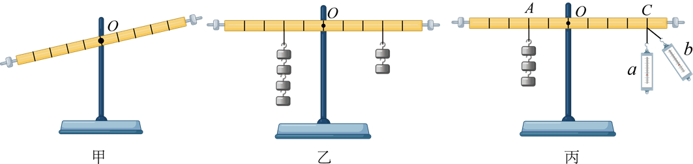

# Physics - 题目 677

**ID**: 31ed74571bfb428e9d9d8af5de61a841
**年级**: Grade 8
**难度**: Medium
**题型**: Experiment

## 题目
如图所示是小李利用刻度均匀的轻质杠杆探究“杠杆平衡条件”的实验装置。​​​​​​​‌（1）如图甲所示，为了使杠杆水平位置平衡，则应将左端的平衡螺母向（选填“左”或“右”）调节；（2）杠杆平衡后，小李在左右两侧分别挂上钩码，如图乙所示，杠杆在端会下沉。（3）如图丙所示，保持杠杆水平位置平衡，测力计从a位置转到b位置，其示数将（选填“变大”、“变小”或“不变”），原因是。

## 解答

1. （1）[1]调节杠杆在水平位置平衡，杠杆右端偏高，平衡螺母应向上翘的右端移动，使杠杆在水平位置平衡，力臂在杠杆上，便于测量力臂大小，同时消除杠杆自重对杠杆平衡的影响。
2. （2）[2]设杠杆每个格的长度为L，每个钩码的重力为G，根据杠杆的平衡条件：F_{左}L_{左}=F_{右}L_{右}，即左端
3. 4G×2L=8GL
4. 右端
5. 2G×3L=6GL
6. 因为
7. 8GL＞6GL
8. 左端大，故左端下沉。
9. （3）[3]由图中可知a状态时动力臂是最长的，所以当测力计从a位置变化成b位置时，杠杆左边力与力臂的乘积不变，而右边的力臂是在减小的，故要保持平衡，此时测力计的示数将变大。
10. [4] 由题意知当测力计从a位置变成b位置时，测力计的示数将变大，原因是杠杆左边力与力臂的乘积不变，但是由图可以分析出测力计从a位置变成b位置的过程中，杠杆右侧的力臂在减小。根据杠杆平衡条件可以得出弹簧测力计的拉力变大。

## 知识点

**中文**:
  - 探究杠杆的平衡条件实验

**English**:
  - Experiment: Equilibrium Conditions of Levers

---
