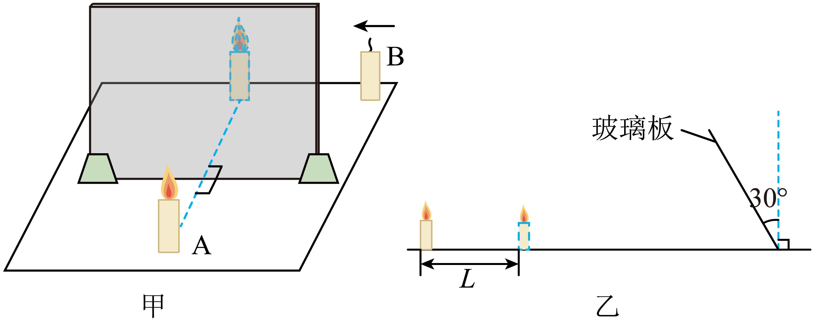

# Physics - 题目 706

**ID**: 32df647cefac404a9b41e0c3d8dd3bb5
**年级**: Grade 8
**难度**: Medium
**题型**: Experiment

## 题目
为了探究平面镜成像特点，小泽同学准备了透明玻璃板、刻度尺、光屏和A、B两只大小相同的蜡烛，如图所示。​​​​​​​‌（1）用透明玻璃板代替平面镜是为了便于确定像的，用玻璃板代替平面镜实验时，应选用（选填“厚”或“薄”）一些的玻璃板，且最好在（选填“较亮”或“较暗”）的环境中实验；（2）当蜡烛A远离玻璃板时，它的像会（选填“变小”、“不变”或“变大”）（3）实验中若只将玻璃板水平向左平移，蜡烛所成像的位置（选填“向左移”、“向右移”或“不变”）（4）小泽同学在实验中将透明玻璃板与水平桌面垂直方向成30°角放置，然后将蜡烛沿水平桌面向玻璃板方向移动一段距离L，如图乙所示。则蜡烛所成像的像距变化量（选填“等于L”、“小于L”或“大于L”）。

## 解答

1. （1）因为薄玻璃板既能反射光，也能看见玻璃板后面的物体。实验时为了便于确定像的位置，用薄玻璃板来代替平面镜进行实验探究。
2. 实验时使用的玻璃板不能太厚，因为玻璃板太厚前后两个面都能成像，会干扰实验。
3. 实验应在较暗的条件下进行，蜡烛的像与周围环境间的差异较大，实验现象更明显。
4. （2）平面镜所成的像与物体等大，所以当蜡烛A远离玻璃板时，它的像大小不变。
5. （3）平面镜所成的像与物体关于平面镜对称，将玻璃板向左移时，没有改变物体与平面镜所在平面的相对位置，所以平面镜中像的位置不变。
6. （4）由图可知，像距变化量等于
7. $AB=\sqrt {L{^{2}}-{\left({\frac {L}{2}}\right)^{2}}}=\frac {\sqrt {3}}{2}L<L$
8. 

## 知识点

**中文**:
  - 平面镜成像特点的探究实验

**English**:
  - Experiment: Characteristics of Plane Mirror Imaging

---
