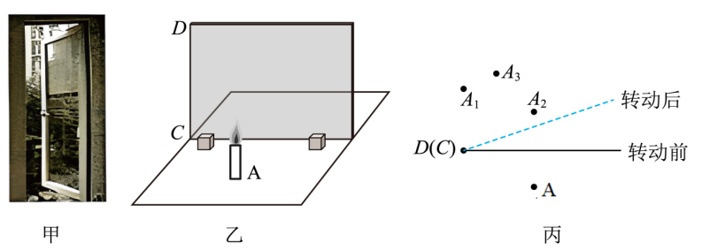

# Physics - 题目 1072

**ID**: 334831e54a7f4c1e8206fa2ae0fa57d8
**年级**: Grade 8
**难度**: Medium
**题型**: Experiment

## 题目
小明观察发现，在玻璃窗中可看到室内物体的影像；在将玻璃窗外推的过程中，可看到窗里影像的位置在发生变化，如图甲，为了搞清楚原因，他进行如下探究。​​​​​​​‌（1）把透明玻璃板放置在水平桌面的白纸上，玻璃板前放一支点燃的蜡烛A，另一支大小相同的（选填“点燃”或“未点燃”）的蜡烛B（图中未画出）放在玻璃板后，如图乙所示；（2）要研究平面镜成像特点，人眼应在蜡烛（选填“A”或“B”）侧观察蜡烛B和蜡烛A的像是否完全重合，记下蜡烛A和B的位置，用刻度尺测量物距和像距并作记录；当蜡烛A靠近玻璃板时，A的像会（选填“变大”“变小”或“不变”），经过多次实验后得出平面镜成像的特点；（3）保持蜡烛A不动，将图乙中玻璃板绕竖直边CD垂直纸面逆时针（俯视）转动一个小角度，如图丙所示，则蜡烛A的像应是在图中的（选填“A_{1}”“A_{2}”或“A_{3}”）位置；（4）请解释在玻璃窗外推过程，看到窗里影像的位置发生变化的原因是。

## 解答

1. （1）在这个实验中，为保证蜡烛B能与蜡烛A的像重合，纸板与平面镜放置要求是垂直放置；实验中，小明应拿另一支大小相同的未点燃的蜡烛B在玻璃板后面移动，直到它跟蜡烛A的像完全重合。
2. （2）平面镜成的像是光的反射形成的，A蜡烛发出的光线经玻璃板反射，被人眼接收，才能看到像，故眼睛在A蜡烛所在这一侧观察蜡烛B；平面镜成像的特点之一是：像与物体等大，与物距大小无关，所以如果把蜡烛A逐渐靠近玻璃板时，它的像的大小将不变。
3. （3）平面镜所成的像与物关于平面镜对称，故保持蜡烛A不动，将图乙中玻璃板绕竖直边CD垂直纸面逆时针（俯视）转动一个小角度，如图丙所示，则蜡烛A的像应是在图中的A_{3}。
4. （4）在玻璃窗外推过程，看到窗里影像的位置发生变化的原因是镜面转动导致物距发生变化，像距改变（或物像连线与镜面垂直或物像关于镜面对称）。

## 知识点

**中文**:
  - 平面镜成像特点的探究实验

**English**:
  - Experiment: Characteristics of Plane Mirror Imaging

---
