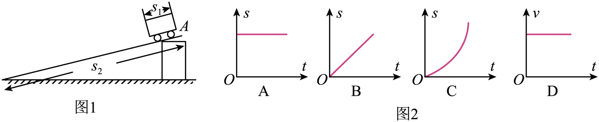

# Physics - 题目 1519

**ID**: 36bb86d4445b4c4db404a2cdd2176250
**年级**: Grade 8
**难度**: Medium
**题型**: Experiment

## 题目
如图1，测平均速度时，测得小车从斜面的顶端A处由静止开始滑到B处所用时间为t，小车长为s_{1}，斜面长为s_{2}。​​​​​​​‌〖实验目的〗测量小车的平均速度〖实验原理〗；〖实验器材〗小车、、、斜面、金属挡板、长方体木块；（1）若小车还没放开之前就已开始计时，则测得的平均速度跟真实值相比偏；（2）图2中能够准确反映小车运动情况的是；（3）让小车在斜面上运动的时间长些，应斜面的坡度。（选填“增大”或“减小”）

## 解答

1. [1][2]测量平均速度的实验中，需要用停表测量小车运动的时间，用刻度尺测量小车运动的路程，再根据公式 $v=\frac {s}{t}$ 计算小车运动的平均速度。故实验原理是 $v=\frac {s}{t}$ 。所缺实验器材是停表和刻度尺。
2. （1）[3]若小车还没放开之前就已开始计时，则测量小车运动的时间偏大，根据公式 $v=\frac {s}{t}$ 得出测得的平均速度跟真实值相比偏小。
3. （2）[4]小车由斜面滑下做加速运动，图2中
4. A．图像中物体静止，故A不符合题意；
5. BD．图像中物体做匀速直线运动，故BD不符合题意；
6. C．图像中物体做加速运动，故C符合题意；
7. 故选C。
8. （3）[5]让小车在斜面上运动的时间长些，应减小斜面的坡度。

## 知识点

**中文**:
  - 测量物体运动的平均速度

**English**:
  - Measuring Average Velocity of an Object

---
