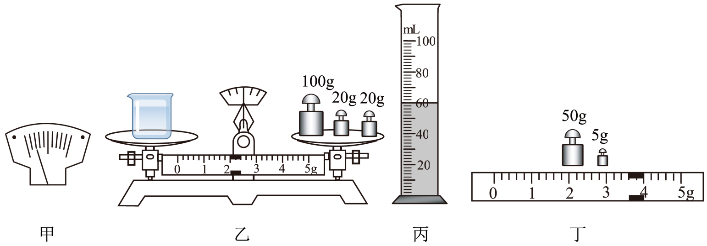

# Physics - 题目 318

**ID**: 3e4af04ca07a4972bbf7766262cf667f
**年级**: Grade 8
**难度**: Medium
**题型**: Experiment

## 题目
小明想知道酱油的密度，于是他和小华用天平和量筒做了如下实验：如图所示。​​​​​​​‌需要完成下面的任务：（1）将天平放在水平台上，把游码移到标尺左端的处，他们发现指针指在分度盘的位置如图甲所示，此时他们应将平衡螺母向（填“右”或“左”）调，直至天平的横梁平衡；（2）实验过程如下：①将烧杯中盛入酱油，并且放在调节好的天平的左盘进行称量，当天平再次平衡时，如图乙所示，则烧杯和酱油的总质量m_{1}=g；②把烧杯中的（选填“部分”或“全部”）酱油倒入量筒中，如图丙所示，则量筒中酱油的体积V=cm^{3}；③把烧杯和剩余酱油放在天平左盘中称量，当天平重新平衡时，所用砝码、游码的位置如图丁所示，则烧杯和剩余酱油的质量m^{2}=g；④量筒中酱油的质量m=g，该酱油的密度ρ=g/cm^{3}。

## 解答

1. （1）把天平放在水平台上，把游码放在标尺的零刻线处；然后调平，调平时指针偏左，说明天平左侧偏重，需要把横梁两端的平衡螺母向右调节，直至指针指在分度盘的中央。
2. （2）①在天平的标尺上，1g之间有5个小格，一个小格代表的质量是0.2g，即天平的分度值为0.2g；烧杯和酱油的总质量 $m1=100g+20g+20g+2g=142g$
3. ②为了减小测量体积时的误差，把烧杯中的部分酱油倒入量筒中，如图，量筒的分度值为2mL，液体的的体积为 $V=60{\rm mL}=60cm{^{3}}$
4. ③烧杯和剩余酱油的质量 $m{{}_{2}}=50g+5g+3.6g=58.6g$
5. ④量筒中酱油的质量 $m=m{{}_{1}}-m{{}_{2}}=142g-58.6g=83.4g$
6. 酱油的密度 $ρ=\frac {m}{V}=\frac {83.4g}{60cm{^{3}}}=1.39g/cm{^{3}}$

## 知识点

**中文**:
  - 液体密度的测量实验

**English**:
  - Experiment: Measuring Density of Liquids

---
