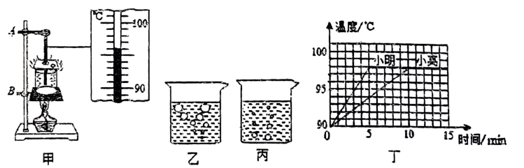

# Physics - 题目 1751

**ID**: 4096b485f8694dd9afe3bb26bda01fc1
**年级**: Grade 8
**难度**: Medium
**题型**: Experiment

## 题目
小明和小亮同学在“探究水沸腾时温度变化特点”的实验中，两人组装的实验装置均如图甲所示。​​​​​​​‌（1）安装实验装置时应先固定（选填“A”或“B”）铁圈，组装前（填“需要”或“不需要”）点燃酒精灯，目的之一是使用酒精灯的给水加热；（2）当水温升到90℃时，每隔1min记录一次温度计的示数，直到水沸腾5min后停止读数，实验中某时刻的温度计示数如图甲所示，此时水的温度为℃；（3）实验中，小明观察到水中气泡上升过程中的两种情况，如图乙、丙所示，则图是水在沸腾时的情况，这时气泡内的气体主要是（选填“空气”或“水蒸气”）；（4）小明和小亮同学根据实验数据分别绘制了温度随时间变化的图像，如图丁所示，分析图像可知：①两人实验时水的沸点为℃，说明当地气压（填“低于”“等于”或“高于”）标准大气压。②水在沸腾时，吸收热量，温度（填“升高”“保持不变”或“降低”）；③实验时小明将水加热至沸腾所用的时间比小亮短，其原因是小明烧杯里的水比小亮（填“多”或“少”）。

## 解答

1. （1）组装实验装置时，应先调整烧杯的位置，因为烧杯的位置需要根据酒精灯外焰的高度来确定，所以应先固定B的位置，需要点燃酒精灯。
2. （2）该温度计的分度值为1℃，液柱上表面与第96条刻度线相平，所以读数为96℃。
3. （3）沸腾时，由于此时整个烧杯内的水温相同，气泡不断升高，深度不断减小，水压不断减小，并且有大量水蒸气进入气泡，气泡逐渐变大，故图乙是沸腾时的情况，这时气泡内的气体主要是水蒸气。
4. （4）①如图丁所示，水的温度达到98℃后保持不变，该温度为水的沸点。
5. 因为水在标准大气压下的沸点为100℃，此时水的沸点为98℃，低于100℃，故说明当地大气压低于标准大气压。
6. ②如图丁，水在沸腾时，持续吸热，但温度保持不变。
7. ③小明实验时水的质量比小亮的小，所以加热更快，用时更短。

## 知识点

**中文**:
  - 探究水的沸腾实验

**English**:
  - Experiment: Boiling of Water

---
