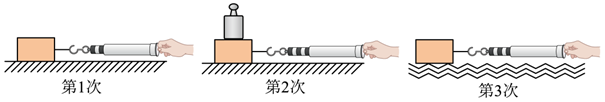

# Physics - 题目 1836

**ID**: 42fe615fc5924e87ad82cfe86a17911c
**年级**: Grade 8
**难度**: Medium
**题型**: Experiment

## 题目
小峰在“探究影响滑动摩擦力大小的因素”实验中，进行了如图所示的操作。​​​​​​​‌实验数据如表格所示，回答下列问题：次数123接触面木板木板毛巾压力/N1.01.51.0弹簧测力计示数/N0.40.60.6（1）实验中，小峰每次都用弹簧测力计沿方向拉着木块做匀速直线运动，此时木块受到的拉力与木块受到的滑动摩擦力是一对力；（2）比较第1、2两次实验数据可知，在接触面的粗糙程度相同时，接触面受到的压力越，滑动摩擦力越大；（3）比较第两次实验数据可知，在接触面受到的压力相同时，接触面越粗糙，滑动摩擦力越大；（4）若在第1次实验中，木块以更大的速度做匀速直线运动，则弹簧测力计的示数（选填“大于”“等于”或“小于”）0.4N；（5）第2次实验中，砝码受到的摩擦力是N；（6）该实验中主要采用的研究方法是。（选填“控制变量法”或“理想实验法”）

## 解答

1. （2）[3]比较第、2两次实验数据可知，接触面的粗糙程度相同而物体间的压力不同，弹簧测力计的示数不同，可得在接触面的粗糙程度相同时，接触面受到的压力越大，滑动摩擦力越大。
2. （3）[4]比较第、3两次实验数据可知，物体间的压力相等而接触面的粗糙程度不同，弹簧测力计的示数不同，可得在接触面受到的压力相同时，接触面越粗糙，滑动摩擦力越大。
3. （4）[5]若在第次实验中，木块以更大的速度做匀速直线运动，木块仍处于平衡状态，压力不变，接触面的粗糙程度不变，摩擦力不变，弹簧测力计的示数等于0.4N。
4. （5）[6]第2次实验中，砝码与木块一起向右做匀速直线运动，若木块受到了摩擦力，则没有力与之平衡，故砝码不受摩擦力。
5. （6）[7]由于影响摩擦力的大小影响的变量有压力的大小和接触面的粗糙程度等两个变量，实验中主要采用的研究方法是控制变量法。

## 知识点

**中文**:
  - 影响滑动摩擦力大小因素的探究实验

**English**:
  - Experiment: Factors Affecting Sliding Friction

---
