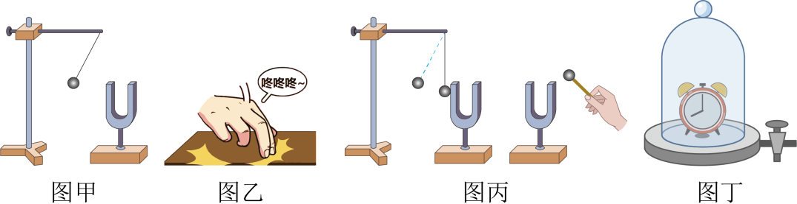

# Physics - 题目 9

**ID**: 45afc62936694b1ba19ff87a703b1754
**年级**: Grade 8
**难度**: Medium
**题型**: Experiment

## 题目
在探究声音的产生与传播时，小明和小华一起做了下面的实验：（1）如图甲所示，小明用悬挂着的乒乓球接触正在发声的音叉，可观察到；小华同学用手使劲敲桌子，如图乙所示，桌子发出了很大的声响，但他几乎没有看到桌子的振动，为了明显地看到实验现象，改进方法是：；（2）如图丙所示，敲响右边的音叉，左边完全相同的音叉也会发声，并且把泡沫塑料球弹起.该实验能说明可以传声；（3）如图丁所示，把正在响铃的闹钟放在玻璃罩内，逐渐抽出其中的空气，听到的声音会逐（选填“变大”“变小”或“不变”），由此推理可知：如果玻璃罩内抽成真空后，就听不到闹钟响铃的声音了，最后得出结论：；你认为得出这一结论是。​​​​​​​‌

## 解答

1. （1）声音是由物体振动产生的，发声的音叉在振动，所以用悬挂着的乒乓球接触正在发声的音叉时会看到乒乓球弹跳起来；为了证明桌面振动可以在桌面上撒一些纸屑或放一些轻小物体，利用轻小物体的振动证明桌面振动。
2. （2）敲响右边的音叉，左边完全相同的音叉也会发声，并且把泡沫塑料球弹起，说明左边音叉也振动，进一步说明声音可以通过空气传播，声音可以传递能量。
3. （3）声音的传播需要介质，用抽气机将瓶内的空气抽出，在抽气机向外抽气的过程中，能传播声音的空气越来越少，所以声音会逐渐变小；如果把瓶中的空气完全抽出来，瓶内就成了真空状态，所以我们不能听到闹钟声，这说明声音靠介质传播，真空不能传声；完全真空的环境实验室做不到，根据瓶中的空气越少，声音越小，推断出真空不能传声，所以该结论是在实验基础上，加科学的推理得出的，故ACD不符合题意，B符合题意。

## 知识点

**中文**:
  - 声音的产生和声源
  - 探究真空不能传声

**English**:
  - Sound Production and Sound Sources
  - Investigation: Vacuum Cannot Transmit Sound

---
