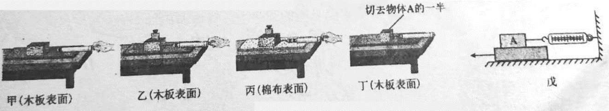
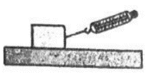

# Physics - 题目 1917

**ID**: 473856774e1e427caf1fe1817a37c7fc
**年级**: Grade 8
**难度**: Medium
**题型**: Experiment

## 题目
为了探究“滑动摩擦力大小与什么因素有关”，小明设计如图所示的实验。​​​​​​​‌（1）实验过程中，弹簧测力计拉着物块保持状态，此时滑动摩擦力的大小（选填“大于”、“等于”或“小于”）弹簧测力计的示数；（2）比较甲、乙实验，得到的结论是；（3）比较甲、丁实验，发现甲实验弹簧测力计的示数大于丁实验弹簧测力计的示数，小明得出结论：滑动摩擦力的大小与接触面积的大小有关。他出现这个错误的原因是；（4）在四次实验中，滑动摩擦力最小的是（选填“甲”、“乙”、“丙”或“丁”）；（5）小明对实验装置进行改动，如图戊所示，重复实验，小明（选填“一定”或“不一定”）要匀速拉动长木板。（6）在操作过程中还发现，弹簧测力计不沿水平方向拉动时，也可以使物块在木板上沿水平方向做匀速直线运动（如图所示），此过程中，物块处于（选填“平衡”或“非平衡”）状态，弹簧测力计对物块的拉力和物块受到的滑动摩擦力（选填“是“或“不是”）一对平衡力。

## 解答

1. （1）实验过程中，弹簧测力计必须沿水平方向拉着物块做匀速直线运动，木块在水平方向受到的拉力和滑动摩擦力就是一对平衡力，它们大小相等，读出测力计的示数，就可知道滑动摩擦力的大小。
2. （2）由图甲、乙所示实验可知，两次实验中接触面粗糙程度相同，压力不同，所以是为了探究滑动摩擦力与压力大小的关系，由此可得出结论：接触面粗糙程度相同时，压力越大，滑动摩擦力就越大。
3. （3）丁所示实验将物体切去一半后，压力变小了，而想探究滑动摩擦力的大小与接触面积是否有关，其他对滑动摩擦力有影响的因素都应控制不变，如接触面的粗糙程度、压力，甲丁两次实验中没有控制物体间的压力相同。
4. （4）滑动摩擦力大小跟压力大小和接触面粗糙程度有关，由图可知，乙丙比较，它们压力相同，乙接触面较光滑；故乙实验中受到摩擦力比丙中小，又甲、乙、丁比较，它们接触面的粗糙程度相同，乙中压力最大，丁中压力最小，则受到的摩擦力f_{乙}＞f_{甲}＞f_{丁}_{，}又f_{乙}＜f_{丙}，故丁实验中木块受到的滑动摩擦力最小。
5. （5）由图戊所示实验可知，无论是匀速还是变速拉动木板，物块都保持不动，滑动摩擦力等于测力计的拉力，所以拉动木板时不一定要匀速拉动。
6. （6）物块在木板上做匀速直线运动，物块受到平衡力作用，处于平衡状态。由于物块受到的滑动摩擦力和拉力不在同一 直线上，故这两个力不是平衡力。

## 知识点

**中文**:
  - 影响滑动摩擦力大小因素的探究实验

**English**:
  - Experiment: Factors Affecting Sliding Friction

---
