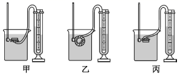

# Physics - 题目 849

**ID**: 478401ca99ae44ddb8bb938f01126d76
**年级**: Grade 8
**难度**: Medium
**题型**: Experiment

## 题目
如图为小明“探究液体内部压强的特点”的实验过程图：（1）小明首先用手指按了按探头的橡皮膜，发现U形管内液柱几乎无变化，其原因是，然后小明重新调整好器材，继续实验；（2）比较图甲、图乙、图丙，得出结论：同种液体，同一深度，；（3）将图甲中的探头逐渐下移，可观察到U形管内液柱的高度差逐渐变大，得出结论：液体密度一定，。​​​​​​​‌

## 解答

1. （1）若压强计的气密性很差，用手指不论轻压还是重压橡皮膜时，就会有漏气现象，导致U形管两边液柱的高度差变化小。
2. （2）金属盒到液面的距离相同时，只改变金属盒的方向，U形管两边液柱的高度差不变，因此同种液体，同一深度，液体向各个方向的压强相等。
3. （3）在乙图中把探头慢慢下移，控制液体的密度不变，改变深度，可以观察到U形管两边液体的高度差增大，得到：在同一种液体里，液体的压强随深度的增加而增大。

## 知识点

**中文**:
  - 探究液体压强的特点实验

**English**:
  - Experiment: Characteristics of Liquid Pressure

---
