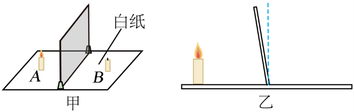

# Physics - 题目 791

**ID**: 49b493c9dc92433593dc3fa8e50b67e0
**年级**: Grade 8
**难度**: Medium
**题型**: Experiment

## 题目
在“探究平面镜成像特点”的实验时，装置如图甲所示：（1）实验应在较（选填“黑暗”或“明亮”）的环境中进行。​​​​​​​‌（2）图甲中，在玻璃板前面放一支点燃的蜡烛A，再拿一支外形相同但不点燃的蜡烛B，在玻璃板后面移动，直到与蜡烛A的像完全重合，这样做是为了比较像与物的关系。（3）如果玻璃板倾斜放置，如图乙所示，平面镜中蜡烛的像的大小（选填“变大”变小”或“不变”），像与物的连线与镜面（选填“垂直”或“不垂直”）。

## 解答

1. （1）为了成像清晰，实验应在较黑暗的环境中进行。
2. （2）依题意得，蜡烛A、B完全相等，蜡烛A用于成像，蜡烛B与像作比较，蜡烛B在玻璃板后面移动，直到与蜡烛A的像完全重合，是为了比较像与物的大小关系。
3. （3）由像与物体等大得，平面镜中蜡烛的像的大小不变；由像与物体关于平面镜对称得，像与物的连线与镜面垂直。

## 知识点

**中文**:
  - 平面镜成像特点的探究实验

**English**:
  - Experiment: Characteristics of Plane Mirror Imaging

---
