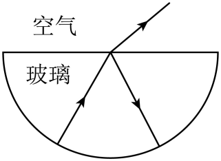

# Physics - 题目 2918

**ID**: 4b83aa72924d4c6dbcbc6f48e50a77a6
**年级**: Grade 8
**难度**: Medium
**题型**: Experiment

## 题目
小明在“探究光折射时的特点”实验中，让光源发出的一束光从玻璃斜射入空气，观察到光束在玻璃中和空气中的径迹如图所示。​​​​​​​‌（1）此现象说明（选填字母）。

## 解答

1. （1）由图可知，图像中入射光线除了在玻璃面发生了反射之外，从玻璃斜射入空气，发生了折射。
2. （2）根据题意和光的折射定律可知，折射角会随着入射角的增大而增大。
3. 光从玻璃斜射入空气中时，由光的折射定律可知，因为空气介质中的角最大，所以折射角要大于入射角，当入射角增大时，空气中的折射角也随之增大，并且当入射角增大到某一值时，折射角将等于90°。
4. （3）根据光的折射定律可知，当光垂直入射时，光的传播方向不变。

## 知识点

**中文**:
  - 光的折射规律的探究实验

**English**:
  - Investigation: Law of Refraction

---
