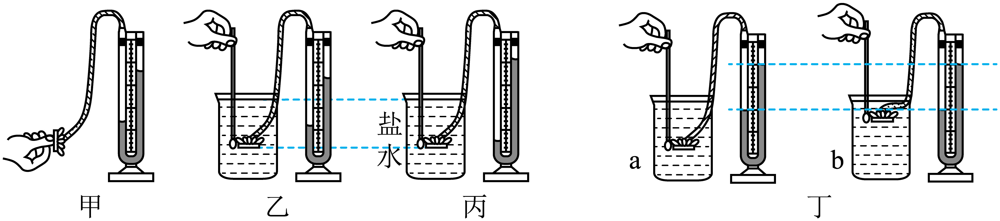

# Physics - 题目 583

**ID**: 5575841e09284d1da55480c02c81cec6
**年级**: Grade 8
**难度**: Medium
**题型**: Experiment

## 题目
小明为探究“影响液体内部压强的因素”，进行了如下实验：（1）如图甲，小明用手指轻按金属盒上的橡皮膜，如果发现U形管两侧液面发生灵活变化，说明该压强计（选填“漏气”或“不漏气”）；（2）将压强计金属盒的橡皮膜朝上逐渐浸入水中某一深度处，如图乙，则压强计显示的是橡皮膜（选填“各个方向”、“上方”或“下方”）的水对它的压强；（3）由乙、丙两图可知：深度相同时，液体的密度，压强越大；（4）同一压强计的金属盒先后放入a、b两种液体中，现象如丁图所示，是否可以比较a、b两种液体的密度大小：，依据是。​​​​​​​‌

## 解答

1. （1）[1]如图甲，小明用手指轻按金属盒上的橡皮膜，如果发现U形管两侧液面发生灵活变化，说明该压强计不漏气，若液面变化不明显，则漏气。
2. （2）[2]将压强计金属盒的橡皮膜朝上逐渐浸入水中某一深度处，如图乙，水在橡皮膜的上方，对橡皮膜有向下的压强，则压强计显示的是橡皮膜上方的水对它的压强。
3. （3）[3]由乙、丙两图可知：深度相同，丙中盐水的密度大于乙中水的密度，且丙中U形管两侧液面液体的高度差较大，说明液体压强计所处位置液体压强大，故深度相同时，液体的密度越大，压强越大。
4. （4）[4][5]如丁图所示，U形管左右液面高度差相等，即液体压强大小相等。根据 $p=ρgh$ ，深度越大，液体密度越小，因此可以判断出a液体的密度小于b液体密度。

## 知识点

**中文**:
  - 探究液体压强的特点实验

**English**:
  - Experiment: Characteristics of Liquid Pressure

---
