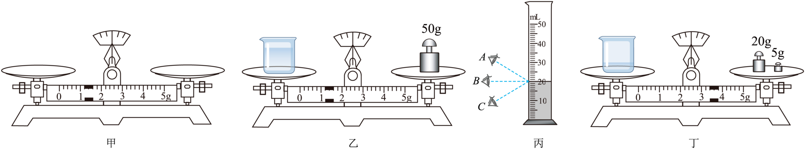

# Physics - 题目 2103

**ID**: 58320387fb7a42e8b58c53b623fac405
**年级**: Grade 8
**难度**: Medium
**题型**: Experiment

## 题目
（1）将托盘天平放置在水平桌面上进行调平，如图甲是他以为已调平的天平。​​​​​​​‌请指出他操作不当之处：；（2）改正不当操作重新调节天平后，他将所测盐水倒入烧杯，并用托盘天平测出烧杯和盐水的总质量如图乙所示；（3）将烧杯中的部分盐水倒入量筒，按图丙中方法读取量筒示数。量筒内的盐水体积V=mL；（4）用托盘天平测得烧杯与剩余盐水的总质量如图丁所示。根据实验数据计算求得盐水的密度ρ=kg/m^{3}。

## 解答

1. （1）调节天平横梁平衡时，先要把游码移到标尺左端的零刻度，由图甲可知，游码没有移到标尺左端零刻度线处。
2. （3）量筒读数时，视线要和液柱的凹面底部相平，故将烧杯中的部分盐水倒入量筒，按图丙中B方法读取量筒示数。
3. 由图知，量筒分度值为 $1{\rm{m}}{\rm{L}}$ ，所以量筒内的盐水体积为 $20{\rm{m}}{\rm{L}}$ 。
4. （4）如图乙所示，横梁标尺的分度值为0.2g，则烧杯和盐水的总质量为m_{总}=50g+1.2g=51.2g，如图丁所示，烧杯与剩余盐水的质量为m_{余}=20g+5g+3.4g=28.4g，则量筒中盐水的质量为m=m_{总}﹣m_{余}=51.2g﹣28.4g=22.8g，则盐水的密度为 $ρ=\frac {m}{V}=\frac {22.8{\rm{g}}}{20{\rm{c}}{\rm{m}}{^{3}}}=1.14{\rm{g}}{\rm{/}}{\rm{c}}{\rm{m}}{^{{\rm{3}}}}=1.14\times {\rm{1}}{\rm{0}}{^{3}}{\rm{k}}{\rm{g}}/{\rm{m}}{^{3}}$

## 知识点

**中文**:
  - 液体密度的测量实验

**English**:
  - Experiment: Measuring Density of Liquids

---
