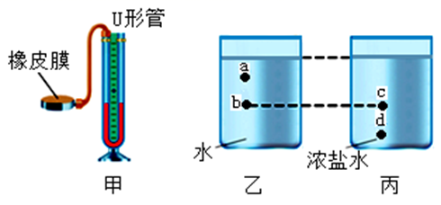

# Physics - 题目 1325

**ID**: 5c0f48d50ead4f8283c7ebeca7520859
**年级**: Grade 8
**难度**: Medium
**题型**: Experiment

## 题目
小明用图甲所示的装置，探究影响液体内部压强的因素：(1)实验是通过观察来反映液体内部压强的大小；(2)在图乙中，将橡皮膜先后放在a、b位置处可知，同种液体，越大，压强越大；(3)为了探究密度对液体内部压强的影响，还需将橡皮膜放在图丙中（选填“c”或“d”）位置处。​​​​​​​‌

## 解答

1. (1)[1]用手挤压橡皮膜时，手对橡皮膜有压强，此压强被空气传递给U型管左侧的液柱，所以，左侧液柱下降，右侧液柱上升，形成U形管中液面高度差。
2. (2)[2]将橡皮膜先后放在a、b位置处，由于b的位置要比a的位置深，由 $p=ρgh$ 知道，b处的压强大； 支持“同种液体，深度越大，压强越大”的实验现象是：橡皮膜所处的深度越深，则U型管液面高度差越大。
3. (3)[3]探究密度对液体内部压强的影响时，需要控制深度相同，所以，还需要将橡皮膜放在图丙中与b等深的c位置处。

## 知识点

**中文**:
  - 探究液体压强的特点实验

**English**:
  - Experiment: Characteristics of Liquid Pressure

---
