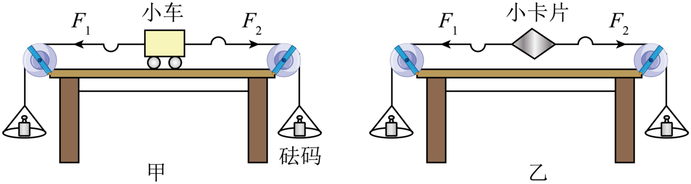

# Physics - 题目 106

**ID**: 5e1b1d52721a4d8ea9a67c8e105336ad
**年级**: Grade 8
**难度**: Medium
**题型**: Experiment

## 题目
物理兴趣小组的同学们利用如图甲所示的装置进行“二力平衡条件”的探究。​​​​​​​‌（1）实验中需要通过调整砝码的来改变小车受到的拉力大小；（2）小组将相同质量的砝码放在左右两盘后，把小车转过一个角度，然后松手，观察到小车转动一定角度后恢复到静止状态，说明两个力必须作用在才能平衡；（3）某次实验中，当左盘砝码质量大于右盘时，小车两边的拉力大小（选填“相等”或“不相等”），但小车仍处于静止状态。此时小车受到的（选填“是”或“不是”）平衡力，产生这一现象的原因可能是小车受到的影响；（4）为尽量减少以上影响，小敏提出将甲装置中的小车换成小卡片，如图乙所示。为了验证只有作用在同一物体上的两个力才能平衡，小敏下一步操作是。

## 解答

1. （1）为验证力的大小对二力平衡的影响，所以实验中需要通过调整砝码的个数来改变小车受到的拉力的大小。
2. （2）把小车转过一个角度，然后松手，观察到小车转动，最后恢复到静止状态，说明小车在水平方向上受到的两个力在同一条直线上时才能平衡。
3. （3）实验中，当左盘砝码质量大于右盘时，小车两边的拉力大小不相等；小车仍处于静止状态，小车仍受平衡力的作用，此时小车有向左运动的趋势，桌面对小车有向右的摩擦力，即小车受到摩擦力的影响。
4. （4）为了验证只有作用在同一物体上的两个力才能平衡，用剪刀把小卡片剪成两个更小的卡片，观察两个更小卡片是否平衡，故B符合题意，AC不符合题意。

## 知识点

**中文**:
  - 二力平衡条件的探究实验

**English**:
  - Experiment: Conditions for Two-Force Equilibrium

---
