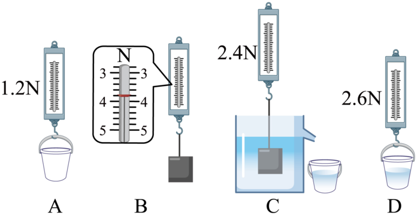

# Physics - 题目 2006

**ID**: 6a58d6c874154485bedb3d1d3aa35bf8
**年级**: Grade 8
**难度**: Medium
**题型**: Experiment

## 题目
某实验小组利用弹簧测力计、小物块、溢水杯等器材，按照如图所示的步骤，探究浮力大小与排开液体所受重力的关系。​​​​​​​‌（1）先用弹簧测力计分别测出空桶和物块的重力，其中物块的重力大小为N；（2）把物块浸没在盛满水的溢水杯中，物块受到的浮力大小为N，物块排开水所受的重力可由（填字母代号）两个步骤测出；（3）由以上步骤可初步得出结论：浸在水中的物体所受浮力大小等于；（4）为了得到更普遍的结论，下列继续进行的操作中不合理的是。

## 解答

1. （1）弹簧测力计的一个大格代表1N，一个小格代表0.2N，弹簧测力计示数是3.8N，所以物块的重力大小为3.8N。
2. （2）石块的重力大小是3.8N，石块浸没在水中弹簧测力计示数是2.4N，所以石块浸没在水中受到的浮力F_{浮}＝G﹣F＝3.8N﹣2.4N＝1.4N
3. 石块排开的水所受的重力可以由实验步骤A、D得到，石块排开的水所受的重力G_{排}＝G_{D}﹣G_{A}＝2.6N﹣1.2N＝1.4N
4. （3） 由以上步骤可初步得出结论：F_{浮}＝G_{排}，即浸在水中的物体所受浮力大小等于石块排开的水所受的重力。
5. （4）A．用原来的方案和器材多次测量取平均值，只能减小测量误差，但是不能寻找普遍规律，故A不合理，A符合题意；
6. B．用原来的方案将水换成酒精进行实验，使用不同密度的液体进行实验，可以避免实验的偶然性，寻找普遍规律，故B合理，B不符合题意；
7. C．用原来的方案将物块换成体积与其不同的铁块进行实验，使用不同体积的铁块可以改变物体排开液体的体积，可以避免实验的偶然性，寻找普遍规律，故C合理，C不符合题意。

## 知识点

**中文**:
  - 实验探究阿基米德原理

**English**:
  - Experiment: Investigating Archimedes' Principle

---
