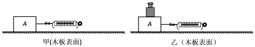

# Physics - 题目 1671

**ID**: 6eb644ef6fb74528a4edabf0f4666293
**年级**: Grade 8
**难度**: Medium
**题型**: Experiment

## 题目
如图所示，在“探究影响滑动摩擦力大小的因素”实验中：（1）将物体A置于水平木板上，用弹簧测力计沿水平方向拉动，使其做运动，此时通过原理可知，滑动摩擦力的大小等于弹簧测力计拉力的大小；（2）小明设计了如图所示的实验方案，通过该实验得到了正确的结论。​​​​​​​‌下列各种现象中，利用该实验结论的是；

## 解答

1. （1）[1][2]用弹簧测力计水平方向匀速拉动木块时，弹簧测力计处于匀速直线运动状态；则弹簧测力计在水平方向上受到了摩擦力和拉力才是一对平衡力，根据二力平衡的原理可知，滑动摩擦力的大小等于弹簧测力计拉力的大小。
2. （2）[3]由实验可知滑动摩擦力大小与压力大小有关；A．汽车在结冰的路面上行驶，在车轮上缠绕铁链是增大摩擦，故A不符合题意；
3. B．用力压住橡皮，擦去写错的字，就是利用改变压力大小来改变摩擦力大小的，故B符合题意；
4. C．移动很重的石块时，在地上铺设滚木是变滑动为滚动减小摩擦，故C不符合题意。
5. 故选B。
6. （3）[4][5][6]实验步骤二：把多支圆柱形铅笔平行放在水平桌面上，将木块A放在其上方，用步骤一的方法拉动木块，记下弹簧测力计的示数 $F{{}_{2}}$ ；实验分析：“用滚动代替滑动可以减小摩擦”说明同等条件下，滚动摩擦小于滑动摩擦，若 $F{{}_{2}}<F{{}_{1}}$ 说明结论是正确的。

## 知识点

**中文**:
  - 影响滑动摩擦力大小因素的探究实验

**English**:
  - Experiment: Factors Affecting Sliding Friction

---
