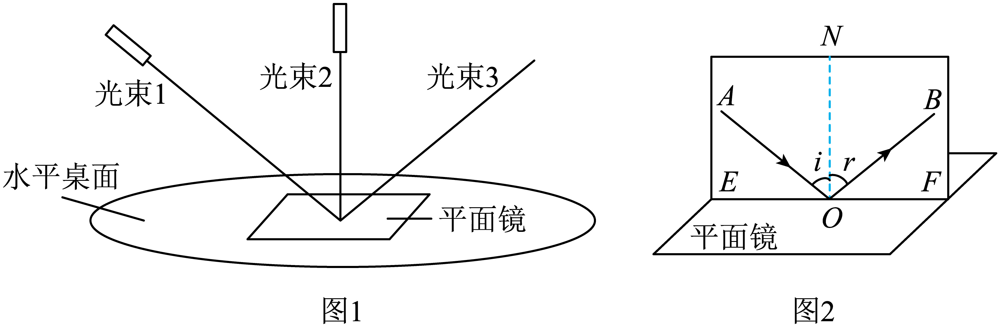

# Physics - 题目 531

**ID**: 7277470a50fe4c608855347f133908bf
**年级**: Grade 8
**难度**: Medium
**题型**: Experiment

## 题目
小阳利用两支激光笔和如图1所示的装置探究光的反射规律，光束2代表的是法线，光束1和光束3分别是入射光和反射光。​​​​​​​‌（1）在实验过程中，当看到的现象时，说明在反射现象中，反射光线、入射光线和法线在同一平面内；（2）接下来小阳继续利用如图2所示的装置探究反射光线与入射光线之间的位置关系。小阳发现，随着入射光位置的不断改变，反射光的位置也在不断改变，但是它们始终位于ON两侧，这说明反射光线与入射光线；（3）为了进一步找到反射光与入射光的位置的准确关系，接下来他应该研究与的关系。

## 解答

1. （1）实验中，从光束1或光束3侧面观察时，三束光线相互遮挡时，说明三束光线在同一平面内，即反射光线、入射光线和法线在同一平面内。
2. （2）在图2中，入射光线的位置发生变化，反射光线的位置也发生变化，但这两种光线总分居在法线ON的两侧，这说明反射光线与入射光线分居法线两侧。
3. （3）为了探究反射光线与入射光线的位置的准确关系，接下来应分别测量反射角和入射角的大小，探究它们的大小关系。

## 知识点

**中文**:
  - 探究光的反射定律

**English**:
  - Investigation: Law of Reflection

---
