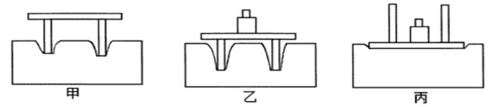

# Physics - 题目 665

**ID**: 73af43e2cba949cdbaefca0a23df1986
**年级**: Grade 8
**难度**: Medium
**题型**: Experiment

## 题目
在探究“影响压力作用效果的因素”实验中，某小组同学利用小桌、砝码、海绵等物品，在水平桌面上进行探究。​​​​​​​‌（1）实验中用反映压力的作用效果，请简述用海绵做实验原因是：；（2）比较甲、乙两图的实验可以得出； 比较丙图和图，可以得出压力一定时，受力面积越小，压力的作用效果越明显；（3）本实验主要采用了的研究方法。

## 解答

1. （1）该实验是通过海绵的凹陷程度来显示压力作用效果的，这用到了转换法。
2. 用海绵做实验原因是：海绵很软，受力易发生形变，形变效果容易观察。
3. （2）图甲和图乙，物体的受力面积相同而压力不同，乙图压力大，乙图力的作用效果明显，由此可得：受力面积相同时，压力越大，压力的作用效果越明显。
4. 图乙和图丙，桌子和海绵间的压力相同而受力面积不同，乙图受力面积小，乙图压力作用效果明显，由此可知：压力相同时，受力面积越小，压力的作用效果越明。
5. （3）影响压力作用效果的因素是压力和受力面积，研究压力的作用效果与受力面积的关系时需要控制压力相同；在研究压力的作用效果与压力大小的关系时需要控制受力面积相同，这用到了控制变量法。

## 知识点

**中文**:
  - 探究影响压力作用效果因素的实验

**English**:
  - Experiment: Factors Affecting Pressure Effect

---
