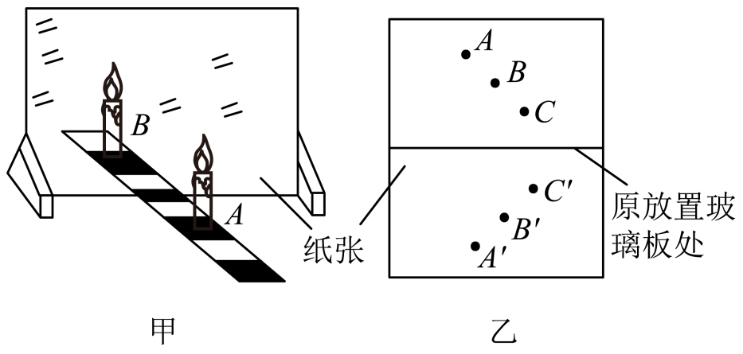

# Physics - 题目 718

**ID**: 7990f82e5ac5430994cf820418fef4f9
**年级**: Grade 8
**难度**: Medium
**题型**: Experiment

## 题目
如图是小明探究“平面镜成像特点”的实验装置：（1）实验探究的步骤正确的顺序是；​​​​​​​‌

## 解答

1. （1）在探究“平面镜成像特点”的实验中，实验步骤应该是先在水平桌面上铺一张白纸，纸上竖立一块玻璃板作为平面镜，再点燃蜡烛做实验，为得到普遍规律，应改变玻璃板前蜡烛的位置，多做几次实验，故实验探究的步骤正确的顺序是： 在水平桌面上铺一张白纸，将一块玻璃板后面竖立在纸上，在纸上记下玻璃板的位置；选取两支大小相同的蜡烛，把一支蜡烛点燃放在玻璃板的前面，看到玻璃板后面有蜡烛的像时，在纸上记下蜡烛的位置A；拿另一支没有点燃的蜡烛，竖立着在玻璃板后面移动，直到它与前面的蜡烛的像完全重合，在纸上记下该蜡烛的位置A′；移动点燃的蜡烛到另一位置，重做上面的实验，在纸上记录物与像的位置B、B′；C、C′。即实验探究的步骤正确的顺序是C、D、B、A。
2. （2）平面像成的是虚像，而虚像不能在光屏上呈现，为研究像与物的大小，取两支完全相同的蜡烛，当后面的蜡烛和前面蜡烛的像完全重合时，这样就证明了像与物大小相同，所以取两支蜡烛完全相同是为了便于比较像与物的大小。
3. （3）设玻璃板的厚度为d, 蜡烛A距离玻璃板的前反射面的距离为l，根据像与物到镜面的距离相等，则蜡烛A经玻璃板的前反射面成的像距离前反射面的距离为l，蜡烛A距后反射面的距离为l+d
4. 经玻璃板的后反射面成的像距离后反射面的距离为l+d
5. 已知测得两个像之间的距离为0.4cm，即(l+d) -(l-d)=2d=0.4cm
6. 则玻璃板的厚度为d=0.2 cm
7. （4）当将玻璃板水平向右移动时，因像和物体始终关于镜面对称，则像相对于蜡烛A位置是不变的。
8. 当玻璃板移动到某个位置，玻璃板反射的光线能进入同桌的眼睛，同桌可能看到蜡烛的像。

## 知识点

**中文**:
  - 平面镜成像特点的探究实验

**English**:
  - Experiment: Characteristics of Plane Mirror Imaging

---
