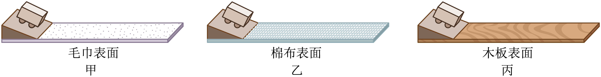

# Physics - 题目 906

**ID**: 7ad57e057d684ae0bb633d5c249f3cdc
**年级**: Grade 8
**难度**: Medium
**题型**: Experiment

## 题目
如图所示，在“探究阻力对物体运动的影响”时，器材有斜面、毛巾、棉布、木板和小车。​​​​​​​‌（1）实验时要固定斜面，并让小车从同一斜面上同一位置由静止滑下，目的是使小车每次到达水平面时有相同的。（2）水平面上三种表面的粗糙程度不同，是为了使小车在水平面上运动时受到的阻力（选填“相同”或“不同”）。（3）根据实验现象可以得出结论；小车受到的阻力越，速度减小得越慢，在水平面上运动的距离越。（4）推论；如果小车在水平面上运动时受到的阻力为零，则小车将保持（选填“静止”或“匀速直线运动”），说明运动的物体（选填“需要”或“不需要”）力来维持。这就是著名的牛顿第一定律，又叫惯性定律。（5）小毅发现在水平路面上用力推小车一段距离后放手，小车仍然能向前滑行一段距离，之后改变小车承载物体的质量多次实验，根据所学的知识，下列解释正确的是（填序号）

## 解答

1. （1）实验中，为了使小车每次到达水平面时有相同的速度，需要让小车从同一斜面上同一位置由静止滑下。
2. （2）水平面上三种表面（毛巾、棉布、木板）的粗糙程度不同，根据影响滑动摩擦力大小的因素，接触面越粗糙，滑动摩擦力越大，所以是为了使小车在水平面上运动时受到的阻力不同。
3. （3）观察中的实验现象，毛巾表面最粗糙，小车受到的阻力最大，运动距离最短；木板表面最光滑，小车受到的阻力最小，运动距离最长。由此可以得出结论：小车受到的阻力越小，速度减小得越慢，在水平面上运动的距离越远。
4. （4）根据前面的实验结论进行推理，如果小车在水平面上运动时受到的阻力为零，即小车在水平方向上不受力的作用，小车将保持匀速直线运动，这说明运动的物体不需要力来维持。
5. （5）A． 惯性是物体的一种性质，不是力，不能说受到惯性力作用，故A错误；
6. B． 一切物体在任何情况下都有惯性，静止的小车也有惯性，故B错误；
7. C． 惯性大小只与物体的质量有关，小车承载物体的质量越大，惯性越大，故C正确；
8. D． 惯性大小与质量有关，与速度无关，小车速度越大，质量不变，惯性不变，故D错误。

## 知识点

**中文**:
  - 阻力对物体运动影响的探究实验

**English**:
  - Experiment: Effect of Resistance on Motion

---
