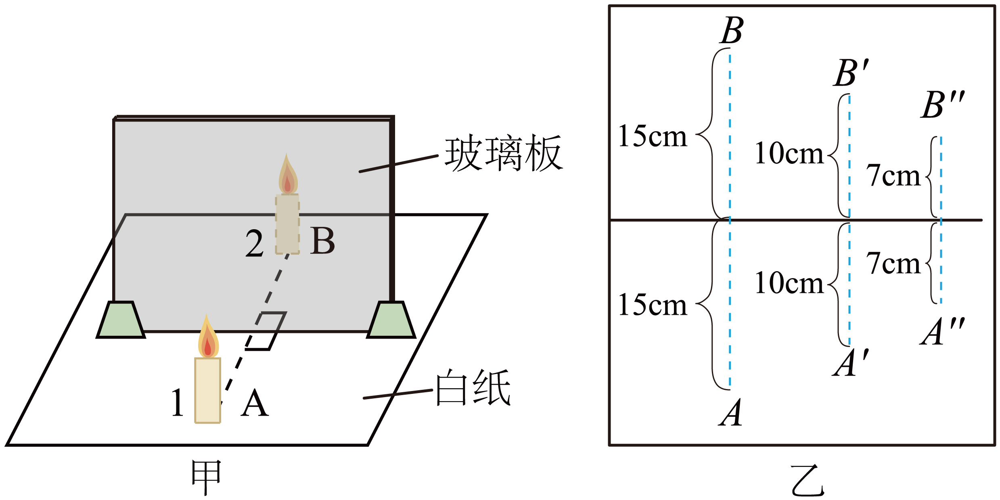

# Physics - 题目 292

**ID**: 7baf91df2d3e4d23ba30b9d35c9d7c00
**年级**: Grade 8
**难度**: Medium
**题型**: Experiment

## 题目
在探究“平面镜成像的特点”时，有以下操作：（1）将一张白纸平铺在水平桌面上，并将一块薄玻璃板竖立在白纸中间位置，沿着玻璃板在纸上画一条直线，代表的位置。​​​​​​​‌（2）如图甲所示，将点燃的蜡烛1放在玻璃板前面，在玻璃板后面移动另一根蜡烛2，发现2与1的像能完全重合，在比较像与物的位置关系时，蜡烛2替代的是（选填“蜡烛1的像”或“蜡烛1”）。多次改变蜡烛1的位置，并在白纸上记录每次蜡烛1和像的位置，图乙是实验中记录的数据，由此可得出的结论是：。（3）当蜡烛1从距玻璃板2cm处以 $5{\rm{c}}{\rm{m}}{\rm{/}}{\rm{s}}$ 的速度远离玻璃板，运动2s时蜡烛1与其像相距cm。

## 解答

1. （1）为了便于记录平面镜的位置，便于测量物距和像距，则沿着玻璃板在纸上画一条直线，代表平面镜的位置。
2. （2）在比较像与物的位置关系时，当蜡烛B和蜡烛A的像完全重合时，则蜡烛B的位置就是像的位置，因此蜡烛B替代的是蜡烛A的像；多次改变蜡烛1的位置，并在白纸上记录每次蜡烛1和像的位置，观察图乙可知，每次对应的像距与物距相等，所以可得：像与物到平面镜的距离相等。
3. （3）沿垂直板面方向将蜡烛1以5cm/s的速度远离玻璃板，运动2s时蜡烛1距离平面镜的距离为 $s=2{\rm{c}}{\rm{m}}+2\times 5{\rm{c}}{\rm{m}}=12{\rm{c}}{\rm{m}}$ ，根据像与物体到平面镜的距离相等可得蜡烛1与其像相距12cm+12cm=24cm。

## 知识点

**中文**:
  - 平面镜成像特点的探究实验

**English**:
  - Experiment: Characteristics of Plane Mirror Imaging

---
