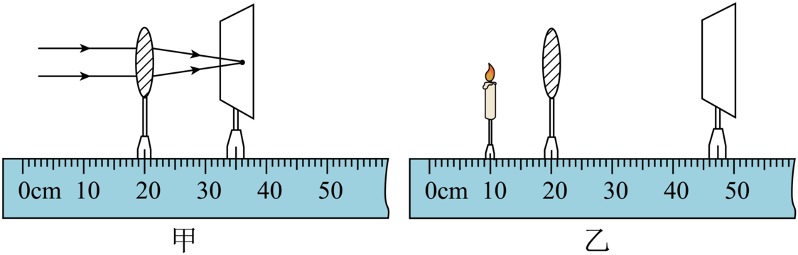

# Physics - 题目 2636

**ID**: 7bd0a6afc30746e085813a685774cc71
**年级**: Grade 8
**难度**: Medium
**题型**: Experiment

## 题目
在“探究凸透镜成像规律的实验”中：（1）如图甲所示，是小贾同学确定焦距时所做的实验，一束平行主光轴的光线经凸透镜后，在光屏上形成一个最小、最亮的光斑，则该凸透镜的焦距为cm；（2）如图乙所示，小贾同学保持蜡烛和凸透镜的位置不变，左右移动光屏，在光屏上（选填“能”或“不能”）得到清晰的烛焰像。​​​​​​​‌此时取下光屏，从原光屏处透过透镜看蜡烛，看到的是烛焰的像（选填“正立”或“倒立”）；（3）在图乙中保持蜡烛的位置不安，把凸透镜向右移到刻度为30cm处，适当调节光屏（光具座足够长），光屏上能成一个的像；此时保持凸透镜位置不变，仅将蜡烛和光屏对调，光屏上又能成一个的像（两空均选填“放大”、“缩小”或“等大”）；（4）实验一段时间后，蜡烛因燃烧变短，所成像移动屏顶端，要使像能够成在光屏的中央，应将凸透镜向（选填“上”或“下”）调整；（5）小贾同学在调整凸透镜时，手上的墨水涂在了透镜中央，形成了一个黑色指纹，则此时在光屏上看到蜡烛的像。

## 解答

1. （1）[1]平行于主光轴的光线经凸透镜折射后会聚在主光轴上一点，这点是凸透镜的焦点，焦点到光心的距离是凸透镜的焦距，所以该凸透镜的焦距
2. $f=35{\rm{c}}{\rm{m}}-20{\rm{c}}{\rm{m}}{\rm{=}}15{\rm{c}}{\rm{m}}$
3. （2）[2][3]由图乙可知，此时的物距
4. $u=20{\rm{c}}{\rm{m}}-10{\rm{c}}{\rm{m}}=10{\rm{c}}{\rm{m}}{\rm{<}}15{\rm{c}}{\rm{m}}$
5. 烛焰在凸透镜1倍焦距以内，成正立放大的虚像，光屏不能承接虚像。
6. （3）[4]在图乙中保持蜡烛的位置不安，把凸透镜向右移到刻度为30cm处，此时物距
7. $u^{′}=30{\rm{c}}{\rm{m}}-10{\rm{c}}{\rm{m}}=20{\rm{c}}{\rm{m}}$
8. 这时，f<u<2f，成倒立放大实像。
9. [5]此时保持凸透镜位置不变，仅将蜡烛和光屏对调，由于光路是可逆的，此时的物距大于二倍焦距，像距在一倍焦距和二倍焦距之间，成倒立缩小的实像。
10. （4）[6]蜡烛变短了，光屏上的像会向上移动，要使像成在光屏的中央，根据光线过光心不改变方向，凸透镜可向下移动，或光屏向上移动，蜡烛向上移动。
11. （5）[7]当透镜上粘上黑色指纹时，还有另外的部分光线，经凸透镜汇聚成像，像的大小和形状不发生改变，但由于透过透镜的光线减小，所以像会变暗，故AB不符合题意，C符合题意。
12. 故选C。

## 知识点

**中文**:
  - 凸透镜成像规律的探究实验

**English**:
  - Experiment: Imaging Rules of Convex Lenses

---
