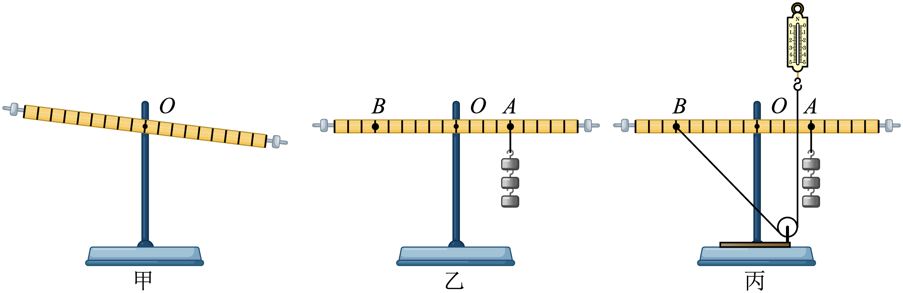

# Physics - 题目 508

**ID**: 7ff9fed5e0b74975ade25496e810122e
**年级**: Grade 8
**难度**: Medium
**题型**: Experiment

## 题目
在探究杠杆的平衡条件时，小阳准备了铁架台、杠杆（每一小格的距离相等）、多个质量均为50g的钩码、弹簧测力计等器材，如图所示。​​​​​​​‌（1）为使甲图中杠杆在水平位置平衡，应将平衡螺母向侧调节；（2）将杠杆调节为水平平衡后，小阳在杠杆右侧的A处悬挂三个钩码，如乙图所示。为使杠杆仍在水平位置平衡，可在B处悬挂个钩码；（3）在铁架台的底座上固定一个滑轮，将细绳的一端系于B处，再绕过滑轮与弹簧测力计相连，如丙图所示。弹簧测力计竖直向上对细绳施加拉力，使杠杆在水平位置平衡，此时弹簧测力计的示数可能为。

## 解答

1. （1）由图甲可知，杠杆的左端上翘，右端下沉，应将杠杆的平衡螺母向左调。
2. （2）设每个钩码的重力为G，杠杆每格的长度为L，B处挂的钩码数为n，由平衡条件可得 $3G\times 4L=nG\times 6L$ ，解得n=2，则应在B处挂两个钩码。
3. （3）由图可知，左边杠杆与拉力的夹角约为45°，OB为6L，由数学知识可知，左端的力臂为 $\frac {6L}{\sqrt {2}}$ ，由题可知，根据重力的计算公式可得，钩码的重力 $G=mg=50\times 10{^{-3}}\mathrm{k}\mathrm{g}\times 10\mathrm{N}\mathrm{/}\mathrm{k}\mathrm{g}=0.5\mathrm{N}$ ，根据杠杆的平衡条件有 $\frac {6L}{\sqrt {2}}\times F=4L\times 3\times 0.5{\rm{N}}$ ，解得，弹簧测力计的示数 $F=\sqrt {2}\approx 1.4\mathrm{N}$ ，只有A接近，故A符合题意，BC不符合题意。

## 知识点

**中文**:
  - 探究杠杆的平衡条件实验

**English**:
  - Experiment: Equilibrium Conditions of Levers

---
